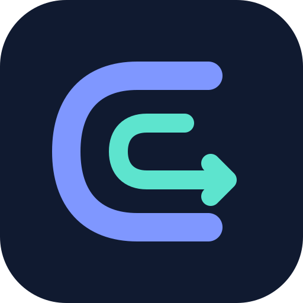

<p align="center">
  
</p>

# CCRouter

[简体中文](README.md) | [English](README.en.md) · [Icon design](docs/brand/ccrouter-icon-v1/README.md)

CCRouter is a component runtime and type-safe routing framework for large Flutter applications. It unifies component assembly, route contracts, navigation policies, lifecycles, cross-component capability calls, and diagnostics around a stable Core Contract, using native Flutter RouterDelegate + Navigator.pages with backend-neutral Host SPI.

The current version is `0.1.0`, intended for validation in this repository's Workspace, Demo, and controlled application pilots. All packages currently declare `publish_to: none`; none have been published to pub.dev or a private hosted registry. Before integrating an external project, complete a formal release or use controlled Git dependencies. Do not copy this repository's Workspace dependency declarations directly into another repository.

This repository **is not yet ready for a formal release**. Blocking items include licensing, historical credential remediation, the package release set, package-level README/CHANGELOG files, hosted distribution, and clean-consumer regression checks. See [`docs/CCRouter-release-readiness.md`](docs/CCRouter-release-readiness.md). A design document marked “complete” does not make the current commit a stable `1.0.0` release.

## Why CCRouter

- **Explicit component boundaries**: components collaborate through Manifests, Route Contracts, Service Contracts, Commands, and Events, without depending on other components' page implementations.
- **Type-safe navigation**: generated Intents enforce argument and result types at compile time, avoiding scattered string paths and `Map<String, dynamic>` values.
- **Replaceable backends**: business code calls only `CCRouter.navigator`; Hosts can implement optional backend-neutral SPI.
- **Controlled lifecycles**: Runtime, Session, Route Entry, Service, and Adapter have explicit owners and teardown order.
- **Separate policy and observation**: Interceptor/PopGuard make decisions; Aspects, Lifecycle, and diagnostic events observe them.
- **Generation first**: one command generates route registrations, Package Indexes, Host Catalogs, and documentation, without runtime reflection.
- **Safe mixed navigation**: foreign routes, dialogs, popups, and overlays must not accidentally dispose of CCRouter-managed Route Scopes.
- **Testable and diagnosable**: dedicated entry points support Pure Dart Runtime tests, Flutter Host tests, bounded traces, and stable error types.

## Package Layout

| Package | Purpose | Direct dependency for business code? |
| --- | --- | --- |
| `ccrouter_contracts` | Pure Dart Route, Service, Command, Event, error, and navigation contracts | Standalone contracts packages only |
| `ccrouter_core` | Runtime, Registry, Scope, scheduling, and diagnostic implementations | No |
| `ccrouter` | Flutter business facade, `CCRouterApp`, and page lifecycles | Yes |
| `ccrouter_ui` | Optional typed UI Fragments, Renderers, and static Host assembly | Optional |
| `ccrouter_generator` | Annotation processing, Host aggregation, validation, lookup, and cleanup CLI | Dev dependency only |
| `ccrouter_analyzer_plugin` | Live boundary and generated-artifact diagnostics in Analysis Server | Dev dependency only; explicit opt-in |
| `ccrouter_devtools` | Embeddable read-only Component/Route/Trace/Failure/InitTask diagnostic panel | Optional Flutter dependency |
| `ccrouter_devtools_protocol` | Pure Dart versioned Static Catalog/Runtime Snapshot/Trace Edge protocol | Tools and Host adapters only |
| `devtools/ccrouter_extension` | Official read-only Flutter/Dart DevTools extension | Development tools only |
| `ccrouter_test` | Test Hosts, fakes, and helpers for integrators | Test/dev dependency only |
| `demo` | Android, iOS, macOS, Web, and OHOS Hosts with complete capability examples | Example |
| `demo/modules/*` | Example components, standalone contracts packages, and application-layer adapters | Examples |

Initialization, consent, identity, and upload policies for vendor SDKs such as Firebase belong to the application layer. `demo/modules/analytics_firebase` only demonstrates mapping provider-neutral events to application-owned Firebase callbacks. It is not a framework package and does not imply a CCRouter dependency on, or compatibility commitment to, Firebase.

Business and component code should normally import only:

```dart
import 'package:ccrouter/ccrouter.dart';
```

Only the application Composition Root may import `package:ccrouter/ccrouter_host.dart`. Business code must not import `ccrouter_core/src/*`, adapters, or Host SPI.

`CCRouterHost.initialize`, `CCRouterHost.shutdown`, and `CCRouterHost.runInitTasks` are available only through `ccrouter_host.dart`; the assembly type `CCHostAssembly` also belongs exclusively to the Host API. The business entry point `CCRouter` does not expose these three methods or retain legacy entry points or compatibility forwarding. Session `openSession/closeSession` and read-only `initTasks` remain business APIs. Multiple navigation Hosts share the default Runtime; closing one navigation Host must not shut down that Runtime.

The optional Analyzer Plugin uses `ccrouter_host_lifecycle_access` to reject component imports/re-exports of lifecycle entry points and checks `CCRouterHost` access through public barrels by framework declaration identity. Host roles are determined from `.metadata`, `ccrouter.yaml`, and direct dependencies. The diagnostic targets component package `lib/` sources, excluding tests, tools, and generated artifacts. It cannot automatically distinguish composition files from pages inside the same Host package; code review remains necessary. Dart export boundaries apply independently of the plugin.

### Cross-component Local UI

For a component-owned order summary or recommendation list, opt in to
`ccrouter_ui`. The owner declares `@CCUIFragmentContract<Props, Action>` in a
Pure Dart contracts package and provides `@CCUIFragmentRenderer(Contract)` in
its implementation package. The consumer declares the required contract,
version range, and method alias in `CCComponent.uiDependencies`, keeps the
owner in `dependencies`, and imports only public contracts and its own
generated `<componentId>.ui.api.g.dart`, never the owner's Widget or Renderer.

The consuming Host, consumer component, and Renderer package directly depend
on `ccrouter_ui`. The existing `generate <host>` command validates UI metadata
and wraps the Host Assembly; startup still passes one
`ccrouterGeneratedHostAssembly`. A legacy Host with Renderers but no declared
UI consumer does not enable UI assembly or need a new direct dependency.
Components without UI declarations require no migration or new Flutter import.
The original five Contract kinds and Service proxy restrictions retain their
semantics. UI metadata uses an opt-in schema; adopters must use the matching
Generator, Contracts, CCRouter, and UI packages together.

The current implementation supports final, const DTO Props without inheritance (scalars, plain
enums, and nested DTOs), with plain enum or equally restricted immutable DTO Actions. Collections, sealed Actions,
function Props, dynamic Slots, and Renderer replacement are unsupported.
Scalars are supported as DTO fields, not as the Action type itself.
Enums cannot declare custom members, constructors, mixins, or interfaces.
DTOs use `this.field` parameters or constant field declarations; both default
forms enter the fingerprint. Initializer-list assignments and redirecting
constructors are unsupported. Typed `onAction` callbacks do not relax Service
restrictions on Widget, BuildContext, callbacks, or Streams. Flutter Key/State
owns instance identity, updates, and disposal; `active` is Host permission,
not automatic exposure detection. Runtime shutdown invalidates old Actions;
after reinitialization the Host must explicitly remount the UI subtree.

Use an ordinary Flutter package for presentation-only reuse and Route for a
complete routed page. See the [UI Fragment design](docs/CCRouter-ui-fragment-design.md).

The [UI integration guide](skills/ccrouter-integration-development/references/ui-fragments.md)
covers the complete contracts/Renderer/consumer/Host path and generation error repairs.
Multiple instances share one dependency and use distinct Keys. B can return its privately
loaded selection ID through an immutable DTO Action. Changing enum to DTO requires
major Contract SemVer and regeneration of A/B/Host. DTO uses UI schema 2 / Index
schema 4; old generators reject it. The
[UI Fragment specification](docs/CCRouter-ui-fragment-design.md) records current capabilities, integration boundaries, and remaining scope.
The Demo's Showcase entry demonstrates multiple instances, Tab retention,
Props updates, account-key recreation, and business errors.
The optional Analyzer Plugin checks UI aliases, repeated dependencies, clearly
invalid ranges, enum/DTO Actions, Renderer signatures, and Host/Generated SPI
boundaries. It offers a conservative missing required Owner fix only when the
public constant is already imported. Validated Generator snapshots bridge Host
closure errors into the IDE; full Props schemas and final correctness remain
owned by `generate --check`.
UI dependency checks require an actual framework constructor; ordinary functions
returning the same type do not trigger those checks or fixes. Owners retain their
declaration library and symbol identity. Renderers must be library-level functions,
not functions nested inside another function or method.
Resolved typedef constructors for `CCComponent` and `CCUIFragmentDependency`
support the same Owner checks and fixes. Regenerate metadata for contracts in
`part` files to record source locations separately from defining-library identity.
For a first integration, `create ui-fragment ... --dry-run` previews a Contract,
public barrel and optional Renderer without editing existing configuration.
Follow its dependency steps and import both the public Contract and
`package:ccrouter_ui/ccrouter_ui.dart` in the Consumer component definition.
After generation, `find <ui-id> <host-root> --usage <consumer-id>` reports proven
imports and the actual Client alias. Old indexes need regeneration. The scaffold
still emits enum Actions; see [Action schema and compatibility](docs/CCRouter-ui-fragment-design.md#action-schema-与兼容) for dynamic selection results.
Each participating Contract, A and B Package needs a `ccrouter_generator` dev dependency;
the Host also needs `build_runner`. The `ccrouter_ui` framework dependency does not
require business component Portable State; distributed business Packages retain that validation.

The [independent adoption validation](docs/validation/ui-fragment-adoption-20261020/README.md)
provides reproducible enum/DTO sources, logs, and sample-specific edit costs.
The local technical workflow is verified; first use by an uninvolved developer,
distribution, real platform coverage, and long-term memory/performance remain
unvalidated. The public API is not finally frozen.

### IDE / Analysis Server Diagnostics

Generated Route APIs already provide type completion and automatic imports. To check cross-component references to internal generated artifacts, missing same-source Route/Service/Command/Event/InitTask artifacts, and required InitTask declarations while editing, explicitly add `ccrouter_analyzer_plugin` and enable it in `analysis_options.yaml`:

```yaml
analyzer:
  exclude:
    - tool/ccrouter_analyzer_host/tools/analyzer_plugin/**
  plugins:
    - ccrouter_analyzer_plugin
```

The isolated loader is not part of the Host application's dependency graph. Host `dart analyze` / `flutter analyze` must exclude the inner `tools/analyzer_plugin/**` sources; `ccrouter analyzer doctor <host-root>` validates their dependency resolution, analysis, and loader compilation in the isolated graph. The Demo's custom directory uses `tools/ccrouter_analyzer_plugin_host/tools/analyzer_plugin/**` instead.

The plugin provides lightweight diagnostics only. It does not generate code, modify sources in the background, or replace `ccrouter generate --check`. It reads the current Analysis Server overlay, so unsaved `.dart` edits also trigger diagnostics. Initialization scans only developer-authored Dart sources, not platform outputs or generated CCRouter libraries. When `ccrouter generate` or `ccrouter clean` adds, changes, or removes same-source artifacts, the plugin rechecks the corresponding declaration source to clear stale “missing artifact” diagnostics. Component API aggregation and metadata-only Contracts that depend on cross-file Catalogs remain the responsibility of `ccrouter generate --check`; the plugin does not make unreliable single-file guesses.

The plugin uses the same `requestedRoot/resolutionRoot` semantics as the Generator: a Workspace member requires a valid `workspace_ref.json` or exact membership; a standalone nested package does not inherit its parent's Workspace graph. If saved dependencies differ from the resolved graph, the IDE prompts for the appropriate `flutter pub get`/`dart pub get` according to Host, Flutter package-local, or Pure Dart package-local role, even without an active watch. This only suspends Owner inference; it does not execute Pub or generation. When a Workspace root is opened, the plugin builds a bounded index from its manifest's explicit member list, allowing each participating member to receive and clear its own hint. The 500ms poll does not recursively scan the Workspace.

Editing-time checks also cover public/top-level/non-generic Handler shape, clearly unsupported parameter counts and void return shapes, Route `pattern/patterns`, InitTask `contract/id`, literal IDs/aliases/Gate IDs, and computable timeouts. A bounded Owner index built from exact metadata of Pub-resolved packages reports missing required Owners in `serviceDependencies` or `commandDependencies`. Mutually exclusive arguments can be removed explicitly. A developer can apply a single-Owner Quick Fix when the Owner is unambiguous, a public import exposes the exact `CCComponentId`, and `dependencies` is a direct List. When all missing Owners of one component can be uniquely proven, a fix can add them together. The plugin never creates Contracts, guesses identifiers, inserts imports automatically, rewrites complex collections, or runs the Generator.

For Handler types, Owner constants, and Service inheritance, the plugin reuses current Analysis Server resolution on demand. It supports prefixed `Future`, typedefs, const aliases, and import shadowing. Unprovable values are deferred, not guessed from their final names. An `@CCService` with a compatible `dispose()` but no `CCDisposable` triggers a warning; when the interface is explicitly imported, a Quick Fix adds it while preserving existing cleanup code. Directly owned disposable resources outside a Scope receive ownership hints; the plugin does not generate empty `dispose()` methods or release borrowed resources. No warning is not proof of leak freedom; lifecycle tests are still required.

The Demo enables the plugin in `demo/analysis_options.yaml` and supplies the required `tools/analyzer_plugin` bootstrap through `demo/tools/ccrouter_analyzer_plugin_host`. The bootstrap pins a remote Git commit to isolate Analyzer versions. After hosted publication, prefer declaring `ccrouter_analyzer_plugin` in the Host's normal `dev_dependencies`; the adjacent `pubspec.hosted.yaml` provides a hosted manifest. Do not put local Workspace paths directly into the bootstrap: Analysis Server copies it to a temporary directory. See [`docs/CCRouter-ide-analysis-server.md`](docs/CCRouter-ide-analysis-server.md) for setup, pinned refs, hosted fallback, and Analyzer version boundaries.

After manual setup, inspect a specific Host from the Workspace root. These commands read configuration; `doctor` validates locked dependencies, bootstrap analysis, and loader compilation in a temporary copy. They neither run the Generator nor rewrite Host configuration:

```bash
fvm dart run --verbosity=error ccrouter_generator:ccrouter analyzer status demo
fvm dart run --verbosity=error ccrouter_generator:ccrouter analyzer doctor demo
fvm dart run --verbosity=error ccrouter_generator:ccrouter analyzer pin-check demo
```

A `healthy` result from `status` only means the manifest, lockfile, pinned source, and version agree statically; it does not prove that Analysis Server loaded the plugin. A successful `doctor` only proves that the isolated bootstrap can resolve, analyze, and compile with the current credentials in a temporary copy. It reports source pin, legacy cache artifact, restart, and live verification separately, and never equates loader compilation with live IDE success. `pin-check` is a manual maintainer/release check: it validates the Demo's active manifest/lock/`resolved-ref` and full remote SHA, and advises whether production changes under plugin `lib` have occurred since the pin. It is not a hard gate for ordinary plugin PRs.

For the current bootstrap's Analysis Server cache, `doctor` provides advice only. The private `.plugin_manager` is not an authoritative cross-SDK gate. For stale/incomplete entries, it reports candidate PIDs, PPIDs, elapsed time, commands, and exact backup paths when possible, but does not kill, move, or delete anything automatically. Stop Analysis Server through the IDE, confirm the relevant processes have exited, and manually move the entire listed hash entry outside `.plugin_manager`. Do not move only its `analyzer_plugin` subdirectory or clear unrelated caches. After restarting, verify a real diagnostic or Quick Fix.

`dart analyze` cannot prove that the current IDE session loaded the CCRouter Plugin. Dart 3.11.5 initializes the Plugin manager when its analysis scope reaches a Host bootstrap; it can report plugin diagnostics or expose Server/Plugin startup and compatibility failures. It is not necessarily limited to built-in Dart rules. Behavior depends on the SDK, analysis scope, and bootstrap state, and cannot replace validation in Android Studio, IntelliJ, VS Code, or a real Language Server session. `ccrouter generate --check` remains authoritative for cross-file correctness.

The repository includes independent Server-process regressions: run `fvm dart test test/analysis_server_integration_test.dart` from `packages/ccrouter_analyzer_plugin/`. These cover Legacy/LSP fix round trips, unsaved edits, disk changes for five artifact kinds, and Workspace Owner metadata refresh. They do not replace verification that the current IDE loaded the intended bootstrap/ref. See the IDE documentation for SDK and multi-root boundaries.

Hosts with an existing isolated bootstrap can use explicit setup commands. `install`/`upgrade` are legacy maintenance-only commands and emit deprecation notices; after hosted publication, prefer a normal `dev_dependency`. Hosted versions below must already be published; Git sources must use a reviewed full remote SHA:

```bash
ccrouter analyzer install <host-root> --version <published-version> --dry-run
ccrouter analyzer install <host-root> --source git --url <remote-url> --ref <full-commit-sha>
ccrouter analyzer upgrade <host-root> --ref <full-commit-sha>
ccrouter analyzer uninstall <host-root> --dry-run
```

All three write commands support `--dry-run`. Actual operations validate the isolated loader first, then update the Host and run Pub with the Hook disabled. The CLI adds the inner loader path to Host `analyzer.exclude` and records whether it added that item in an ownership marker. Uninstall removes only its own additions; pre-existing matching entries, other excludes, rules, comments, and unknown files are preserved. Conflicting or manually configured bootstraps are not automatically adopted. `status`/`doctor` report a missing loader exclude as incomplete configuration.

New installations use the standard Dart tool directory `tool/ccrouter_analyzer_host`. Older CLI-managed `tools/ccrouter_analyzer_host` installations can still be upgraded or uninstalled in place; commands do not silently move user directories. Failure restores managed configuration and recorded resolution files. Process interruption or concurrent edits preserve transaction recovery records and stop further writes. Write transactions serialize by canonical Workspace Pub owner; locks and recovery records live under project-isolated `CCROUTER_HOME/coordination/v2`, which survives `flutter clean`. `CCROUTER_USE_LEGACY_DART_TOOL_LOCKS=1` temporarily returns these to the Pub owner's `.dart_tool` for A/B comparison. Both modes fail fast if the other mode still holds a lock. The Demo retains its manual bootstrap and existing remote pin. Analyzer setup must not be implicitly attached to `generate`, Pub Hook, or component scaffolding. See the [IDE / Analysis Server and CLI specification](docs/CCRouter-ide-analysis-server.md).

### Read-only DevTools Panel

Once the Host directly depends on `ccrouter_devtools` and regenerates, its Host Assembly automatically includes a static Catalog and DevTools Tool Integration. Debug enables it by default; Profile requires explicit `CCROUTER_DEVTOOLS=true`; Release always disables it. Embed the panel in a debug drawer or internal diagnostic route:

```dart
import 'package:ccrouter_devtools/ccrouter_devtools.dart';

const diagnosticsPage = CCRouterDevToolsPanel();
```

The panel displays static Catalog/Runtime relationships, source locations, a searchable and focusable Component Graph, Managed/Backend Entries, Trace Timeline, Failure/Fallback, InitTask DAG, and capability call chains, all read-only. Source locations are copyable `package:` URIs by default; the Host can map them to its IDE or source browser through `onOpenSource`. The panel never initializes the Runtime, navigates, pops, retries tasks, disposes Scopes, or controls an Adapter. Before initialization, it displays an empty state. The Demo's live diagnostics section reads the generated Host Catalog and exercises static/runtime relationships in both the embedded panel and official Extension. Business components do not register or clean up the Extension manually. See [`docs/CCRouter-devtools.md`](docs/CCRouter-devtools.md) for data boundaries and integration.

## Current Capabilities

| Capability | Status | Notes |
| --- | --- | --- |
| Startup component assembly | Supported | Dependency sorting; duplicate IDs, missing dependencies, and dependency-cycle checks |
| Annotated routes and type-safe Intents | Supported | Paths, URIs, custom schemes, Regex, multiple patterns, Query, Extra, typed results |
| Page presentation | Supported | Platform default, Material, Cupertino, fade, scale, bottom-up, transparent fullscreen |
| Modal Routes | Supported | Dialogs and modal bottom sheets; optional CCRouter contract/lifecycle management |
| Navigation operations | Supported | `push`, `replace`, `go`, `reset`, `open`, `pop`, `maybePop`, `canPop`, optional exact-entry `close` |
| Shell / StatefulShell / Outlet | Supported | Explicit Host assembly, multiple Outlets, and call-level Context targeting |
| Deep Link | Supported | Platform, Notification, and QR ingress; both Host allowlist and Route policy validation |
| Interceptor / Redirect / Defer | Supported | Global and route-level policies, timeout, cancellation, Pending resumption |
| PopGuard | Supported | Shared decisions for business Pop, system back, Cupertino gestures, and predictive back |
| Aspect / Trace / Telemetry | Supported | Bounded, sanitized, and isolated from observer failures |
| Product PV, click/scroll/exposure collection | Application-owned | Framework navigation observations support application integrations; Demo analytics packages are not framework capabilities |
| Page lifecycle | Supported | `PageShow/PageHide`, foreground/background, Mixin and Listener forms |
| Service | Supported | App/Session/Route Scope, singleton/newInstance, keys, stable Contract IDs, lazy async readiness |
| Namespace-aware KV Storage Demo | Supported in Demo | Primitive types, JSON Maps, global/guest/user/API environment/hardware namespaces, replaceable Backend abstraction |
| Command | Supported | Single Handler, typed results, `void`, cancellation, timeout, Trace |
| Event | Supported | Zero or more subscribers, stable ordering, failure isolation |
| InitTask | Supported | One-time DAG, Gates, required/optional failure policies |
| Generator incremental caches and gates | Supported | Content-validated fast path, `--check`, `--no-cache`, `--profile`, concurrency locks, atomic writes |
| Generated indexes and source lookup | Supported | Package/Host Catalogs, `ccrouter find` |
| Read-only DevTools visualization | Supported | Generated Host integration, Catalog/Runtime relationships, source lookup, component dependency focus, capability call chains, Pure Dart protocol, official Extension |
| Navigator 1.0 Backend | Not yet supported | Candidate for the 2.0 phase |
| Generic attach to an existing Router | Not supported | Native Managed already uses Navigator 2.0; custom Backends integrate through Host SPI |
| Dynamic component installation/removal | Not yet supported | Component set is fixed at `initialize` |
| Action Pipeline | Not yet supported | Deferred until real priority, short-circuit, and allowlist scenarios justify its design |
| Full state restoration | Not yet supported | Application-owned demand collection; Core retains no restoration opportunities or replayable state |
| Service annotation generation | Supported | `@CCService` binds the unique direct Contract and generates simple Provider registration |
| Command annotation generation | Supported | Contracts, Handlers, Owner/Consumer Clients, stable IDs, metadata, Catalog |
| Event annotation generation | Supported | Contracts, static Subscriptions, Owner Publication Clients, stable IDs, metadata, Catalog |
| InitTask annotation generation | Supported | Task Contracts, Handlers, typed dependencies, automatic registration, DAG/Catalog, Workspace validation |

Exact Entry close is supported by Native Managed. General atomic `pushAndRemoveUntil`, positional `removeRouteBelow`, and `replaceRouteBelow` are not public CCRouter operations; do not simulate them through repeated Pop calls.

## Requirements

- Dart SDK `^3.10.0`
- Flutter SDK: the Flutter/OHOS Flutter SDK configured through FVM in this repository

First run:

```bash
CCROUTER_PUB_HOOK_DISABLE=1 fvm flutter pub get
fvm dart analyze packages
fvm dart analyze tool
fvm flutter test packages/ccrouter_test/test
fvm dart test --concurrency=1 packages/ccrouter_test/generator_test
fvm flutter test --no-pub demo
fvm dart run --verbosity=error ccrouter_generator:ccrouter generate demo --no-cache --check
```

The repository root aggregates a Dart Workspace; it is not a CCRouter Host. Disable Pub Hook for root dependency resolution. Run static analysis separately for `packages` and `tool`, then test and check generation for the actual Host, `demo/`. Root `dart analyze` enters the Demo's legacy Plugin bootstrap and is not a reliable aggregate gate. Do not report plugin startup failures or root Hook Host-detection failures as Pub dependency-resolution failures.

Run the macOS Demo:

```bash
cd demo
fvm flutter run -d macos
```

## Minimal Integration

### 1. Declare a Component

Each implementation package defines exactly one top-level `const CCComponent`. The Generator discovers it and generates its Registrar, Manifest, route catalog, and simple Service registrations:

```dart
import 'package:ccrouter/ccrouter.dart';

const orderComponentId = CCComponentId('order_component');

const orderComponent = CCComponent(
  id: orderComponentId,
  version: '1.0.0',
  dependencies: [accountComponentId],
);
```

No handwritten Registrar is required. Shells, complex Services, and other extensions without dedicated declarations can use a top-level registration function annotated with `@CCComponentContribution`; the Generator merges it into the same private Registrar. Do not export component definitions, Contributions, or generated assembly entry points from business barrels. Cross-component collaboration uses public contracts packages or explicit public contract libraries.

### 2. Declare an Internal Route

```dart
import 'package:ccrouter/ccrouter.dart';
import 'package:flutter/material.dart';

import 'ccrouter_generated/order_component.api.g.dart';

@CCRoute<String>(
  id: 'order.detail',
  pattern: CCPathPattern('/orders/:orderId'),
  description: 'Order details; return the order ID after confirmation.',
)
final class OrderDetailPage extends StatelessWidget {
  const OrderDetailPage({
    required this.orderId,
    @CCQueryParam() this.tab = 'summary',
    super.key,
  });

  final int orderId;
  final String tab;

  @override
  Widget build(BuildContext context) => Scaffold(
    appBar: AppBar(title: Text('Order #$orderId')),
    body: FilledButton(
      onPressed: () => CCRouter.navigator.pop(result: 'confirmed:$orderId'),
      child: const Text('Confirm'),
    ),
  );
}
```

Page sources **do not need** a `.route.g.dart` `part`. After generation, the IDE can complete Route, Service Proxy, Command, and Event APIs from the component's unique `<componentId>.api.g.dart`.

Business sources should prefer the stable component API entry point:

```dart
import 'ccrouter_generated/order_component.api.g.dart';
```

The Generator maintains this file by `componentId`. Controlled `export/show` declarations expose only type-safe APIs allowed for business use, never Registrars, Bindings, Hosts, Manifests, Metadata, or Route Registration Bridges. Underlying `component/*_api.g.dart` files remain Generator/Host implementation glue; business sources must not depend on them directly. Components without exportable capabilities do not generate empty `.api.g.dart` files.

Use `pattern` for one address and `patterns` for legacy paths or multiple entry points. They are mutually exclusive. If exactly one pattern is reversible, it becomes primary automatically. Multiple reversible patterns require exactly one explicit primary. Generation fails when only Regex patterns exist and no URI can be constructed in reverse.

### 3. Generate Code

Run from the Workspace root:

```bash
fvm dart run --verbosity=error ccrouter_generator:ccrouter generate demo
```

This unified command runs build_runner as needed and generates package-local routing code, component indexes, Host Bundles, Catalogs, and documentation. Generated files live under each package's `lib/src/ccrouter_generated/` and must not be edited manually.

### 4. Namespaced KV Storage (Demo)

`demo/modules/kv_storage` demonstrates a backend-independent KV Storage Service. Normal business calls use `DemoScopedStorage` to resolve data boundaries from Host-provided context, rather than passing account or environment IDs on every read/write:

```dart
final storage = DemoScopedStorage(
  service: DemoNavigationLabServices.demoKeyValueStorage,
  contextProvider: contextProvider,
);

await storage.global.setBool('privacy.accepted', true);
await storage.currentUser.setJson('profile.preferences', {
  'theme': 'dark',
  'notifications': {'enabled': true},
});
```

The lower-level `DemoStorageNamespace` and `CCStorageClient` remain available for Backends, migrations, and tests. Typed operations support `String`, `int`, `double`, `bool`, and JSON Objects. Identical keys in different namespaces do not overwrite each other. JSON is copied on both reads and writes to prevent callers from mutating internal state.

`CCStorageBackend` is the implementation replacement boundary. The Demo defaults to an in-memory Backend, so data is lost on restart. In production, the application Composition Root should supply a file, database, or Secure Storage Backend and select encryption and cleanup policies appropriate to the data. A namespace is not itself a security boundary and does not provide encryption. See [`demo/docs/kv-storage-demo-migration.md`](demo/docs/kv-storage-demo-migration.md) for the Scoped Facade, Session/Environment/Device context binding, and Backend Placement Policy. This is a Demo/application-layer design, not a CCRouter framework storage contract.

### 5. Initialize the Host

The native Managed Backend owns each Host/Outlet stack and projects it through
Flutter RouterDelegate + Navigator.pages. The GoRouter compatibility package,
Host APIs and comparison Demo launchers have been removed. Existing business
Intents, navigator calls, Route Services and typed results remain unchanged.

```dart
import 'package:ccrouter/ccrouter.dart';
import 'package:ccrouter/ccrouter_host.dart';

Future<void> main() async {
  WidgetsFlutterBinding.ensureInitialized();
  CCRouterHost.initialize(hostAssembly: ccrouterGeneratedHostAssembly);
  await CCRouterHost.runInitTasks(gate: CCInitTaskGate.appStarted);
  runApp(const CCManagedRouterApp());
}
```

Initialize with one complete CCHostAssembly. Handwritten Hosts use
CCHostAssembly.fromComponents and include their Catalog in that same Assembly.
CCManagedRouterApp forwards MaterialApp theme, locale, localization, actions,
restoration and debug settings. Its backendFactory runs once and owns routing
configuration; do not wrap it in another MaterialApp or configure a second Router.
Backend inputs are immutable after mounting.

For a custom MaterialApp, explicitly compose:

```dart
final backend = CCManagedRouterBackend(routeCatalog: applicationRouteCatalog);
final app = CCRouterApp.managed(
  backend: backend,
  child: MaterialApp.router(routerConfig: backend.routerConfig),
);
```

initialLocation is a trusted fallback; a non-root platform URI takes precedence
and passes external ingress policy. Set overridePlatformDefaultLocation only
when intentionally ignoring platform startup links. Custom factories forward
both fields. Use CCManagedShellBinding for Shells, CCManagedOutlet for independent
panes, and CCManagedMultiHostBackend.managed for genuinely independent Hosts.
The fallback must resolve to a registered Route in this Host and satisfy its
parameters and policies. The default `/` does not create a home page; register
that destination or select the application's actual entry address.
The Composition Root renders surfaces and controls context-free active-Host
fallback. Pass BuildContext when navigation needs exact Host/Outlet selection.

A navigation snapshots its default Host before async policy. The initial target's
explicit Host wins; later default targets keep that operation's Host through
redirects, failure recovery and defer/resume. Explicit target Hosts still apply,
and Shell/Outlet/parent topology is preserved. Resolution-failure recovery uses
the invocation Host; a removed Host fails rather than rerouting to another one.
Pop receipts retain the dispatch Host and the child's actual Outlet even after
focus changes or teardown, including a root popup above a named Outlet.

`navigationConcurrencyPolicy` defaults to `allow`. `singleFlight` shares identical
unfinished requests and `rejectDuplicate` rejects duplicates. Identity includes
the exact trusted origin, Host/Outlet, operation, Open mode, route ID and URI.
Internal, platform, notification and QR requests never suppress each other's
Interceptor checks. Telemetry source is not a trust boundary; Extra-bearing
requests execute independently, and completed requests do not suppress retries.

Dynamic Host detach ends that registration's uncommitted policy waits, failure
recovery and deferred continuations with `CCRouteCancelledError('host_detached')`
and releases its concurrency gates. Reusing the logical Host ID creates an
independent registration; old work cannot enter it or recover after cancellation.
Unmount the old `CCRouterApp` before mounting the same logical ID again. The
Multi Host Demo includes a Host lifecycle lab for reopening and late decisions.

A factory-returned `CCDisposable` is adopted or reclaimed even during reentrant
Scope closure: lookup fails with `CCScopeClosedError`, but closure joins bounded
reverse-order cleanup. Manage authentication outside factories and never await
an owner's closure from an object being disposed by it. Invocation timeouts keep
`CCInvocationTimeoutError` when cancellation cleanup throws; sanitized diagnostics
record that failure. Explicit token `cancel()` still notifies all listeners and
then throws the first notification error.

Progressive adoption embeds a Managed Outlet or Host in a feature area. It does
not attach CCRouter to an external GoRouter. Business code keeps using the same
Intents while Composition Roots migrate.

Unmounting a Host does not shut down the shared Runtime. The application owner
explicitly awaits CCRouterHost.shutdown(). Runtime releases Adapter resources
before Backend delegate/provider resources. Session close does not dispose the
navigation stack. Startup failure rolls back unpublished Runtime state; await
shutdown before retrying. Cleanup failures must not skip remaining resources.
See the [Managed Demo assembly](demo/lib/demo_managed_router_backend.dart).

### Application Layout and Restoration Demand

Applications select width breakpoints, pane layout and fold policy. The Host
applies its resolved visible Outlet set through
`CCMultiHostNavigationAdapter.setActiveOutlets(hostId: ..., outlets: ...)`;
native Managed synchronizes this selection into the owning Store. Subsequent
navigation, focus and Shell activation preserve it; root overlays only mask it
temporarily. Custom Adapters may implement Host-only
`CCNavigationOutletVisibilityBinding`; other Adapters retain lifecycle/event forwarding.
CCRouter preserves stacks, identity and lifecycle without imposing 600/840
breakpoints. The Demo layout policy lives in `demo/lib/adaptive_layout.dart`.
Full route restoration remains unsupported. Optional demand collection lives in
`demo/lib/restoration_demand.dart` and is owned/disposed by the application,
independent of Runtime startup and DevTools.

### Analytics Events and Page Tracking

Core/Host no longer accept visitor or analytics Session IDs. The Demo bridge
uses an application `identityProvider` at first asynchronous observation
delivery, not at navigation invocation time. Call `resetTracking()` before
Consent/account changes and dispose the bridge at its ownership boundary.

Product analytics belongs to application infrastructure. CCRouter provides
`CCNavigationAspect`, page lifecycle observations, and stable Route/Host/Outlet
correlation. Applications own PV and dwell definitions, clicks, scrolls,
exposure, consent, sampling, queues, persistence, and upload.
`CCDiagnosticSink` remains framework diagnostics, not a product analytics feed.

The Host registers its observation bridge through `navigationAspects` and owns
its lifecycle and foreground timing. Analytics failures must not change
navigation results. PageShow/PageHide describe navigation state, not pixel
visibility or an automatic PV/exposure rule.

The identity, restoration-demand and layout-policy migration is documented in
[framework/application boundaries](docs/validation/20261023-framework-boundaries/README.md).

The Demo includes unpublished application reference packages:
[`demo_analytics`](demo/modules/analytics/README.md),
[`demo_analytics_flutter`](demo/modules/analytics_flutter/README.md), and a
[Firebase callback mapping](demo/modules/analytics_firebase/README.md).
They are not framework APIs or required dependencies.
See the [application analytics boundary](docs/CCRouter-analytics-and-auto-track-design.md).

## Type-safe Navigation

All business navigation goes through `CCRouter.navigator`:

```dart
final result = await CCRouter.navigator.push<String>(
  OrderComponentRoutes.detail(orderId: 42, tab: 'payment'),
  source: const CCNavigationSource.feature('checkout'),
);

await CCRouter.navigator.replace<void>(AccountRoutes.login());
await CCRouter.navigator.go<void>(HomeRoutes.home());
await CCRouter.navigator.reset<void>(HomeRoutes.home());

final handled = await CCRouter.navigator.maybePop();
CCRouter.navigator.pop(result: 'confirmed');
```

Semantics:

- `push`: adds an Entry to the current stack and returns its typed result when that Entry is removed.
- `replace`: replaces the current CCRouter-managed Entry.
- `go`: reconstructs the current Managed Host's declarative stack, including declared parents. Crossing Shells does not require `go`; use `push` when the previous navigation history should remain available.
- `reset`: explicitly makes the destination the new root location.
- `open`: matches an application-internal dynamic URI, defaults to push, and does not provide a typed Pop result.
- `maybePop`: respects PopGuard, Flutter `PopScope`, LocalHistory, and foreign popups; returns whether the backend handled the request.

Native Managed consumes duplicate pending `maybePop` calls for one live Route
without replacing its result or queuing another Pop. Only its actual remover
receives a removal receipt; independent Outlets remain independent. A waiting
call cannot claim another operation's removal. Renderer detach and shutdown end
framework waiting even if application `willPop` work has not completed.
- `pop`: an explicit business return; the result must match the Route's result type, otherwise a standard navigation error is thrown without incorrectly removing the page.

Business code must not call `Navigator.push/pop`, `GoRouter.push/go`, or an Adapter directly to manipulate CCRouter-managed pages. Temporary local Flutter Dialogs/BottomSheets without component-contract requirements may still use native APIs; they are foreign/overlay surfaces and must not affect Managed Route Scopes.

### Closing a covered page instance

Capture `CCRouter.routeEntryHandleOf(context)` during page setup, before async
work or covering navigation. Later call `CCRouter.navigator.close(handle,
result: value)` and inspect `CCRouteCloseOutcome.status`: `closed`, `notFound`,
`unsupported`, or `guardDenied`. Never replace an unsupported exact close with
Pop or infer the target from the current stack. Handles retain no Context,
Route, Scope, arguments, or result and cannot target another Runtime instance.

Close validates the original result type before mutation and runs the selected
entry's global/local managed PopGuards with a business trigger. It completes
only that result and starts Scope disposal once; covering pages and foreign
Popups remain alive. Async Service disposal may still be pending. This is an
explicit business exit, independent of system back and local confirmation UI.

Native Managed supports imperative and declarative entries, retained branches
and exact Shell removal. Covering foreign popups survive even when the selected
Entry is the last page; only that Entry's result and Scope end. Custom Adapters
may opt into Host-only CCNavigationTargetedCloseAdapter.

### BuildContext and Outlet

Normally omit `BuildContext` to use global Host routing. Pass it only when the same route must target the current Shell, Pane, or nested Navigator based on the call site:

```dart
await CCRouter.navigator.push<void>(
  DetailRoutes.detail(id: 1),
  context: context,
);
```

Context is used only for strict nearest-Host/Outlet resolution and is never stored globally. Resolution failure produces an error instead of guessing another Host or Outlet.

### Dynamic URIs

For application-internal runtime addresses:

```dart
await CCRouter.navigator.open(Uri.parse('/orders/42?tab=payment'));
await CCRouter.navigator.open(Uri.parse('myapp://order/42'));
await CCRouter.navigator.open(
  Uri.parse('https://example.com/web?url=https%3A%2F%2Fflutter.dev'),
);
```

Matching operates on URI structure; path segments and query values are decoded by their Codecs. Do not call string-level `decodeComponent` on the entire URI first. Pass a standard web URL as a query parameter or typed argument; do not concatenate an unescaped URL into another query.

### Paths, URIs, and Parameters

Routes support:

- Standard paths: `/orders/:orderId`
- Full URLs: `https://example.com/orders/:orderId`
- Custom schemes: `myapp://order/:orderId`
- Regex for match-only compatibility entry points without reverse URI generation
- Multiple patterns targeting the same page
- Automatic path-parameter conversion
- `@CCQueryParam` scalars, enums, `List<T>`, `Set<T>`, and custom Codecs
- `@CCExtraParam` typed in-process objects; generated bindings preserve static parameter types and validate object types at decode boundaries

Externally shareable data belongs in Path/Query. Never put Tokens, Controllers, large objects, or non-serializable state into URLs. `Extra` is only for short-lived in-process data and is excluded from URIs, generated documentation, and diagnostics. Incorrect types throw `CCRouteParameterError` without the raw value. Do not rely on `Extra` for Deep Links, state restoration, or cross-process transfer.

## Cross-component Route Contracts

Keep component-local routes internal by default. Promote a contract to a standalone Pure Dart contracts package only when another component needs to call it:

```dart
// order_contracts
@CCRouteContract<String>(
  componentId: orderComponentId,
  id: 'order.detail',
  pattern: CCPathPattern('/orders/:orderId'),
)
abstract class OrderDetailRouteContract {
  const OrderDetailRouteContract({
    required this.orderId,
    @CCQueryParam() this.tab = 'summary',
  });

  final int orderId;
  final String tab;
}
```

The page component only binds the implementation:

```dart
@CCRouteImplementation(OrderDetailRouteContract)
final class OrderDetailPage extends StatelessWidget {
  const OrderDetailPage({required this.orderId, this.tab = 'summary', super.key});
  // ...
}
```

Consumers depend on `order_contracts`, not the `order` page package. Preserving route ID, wire names, and result type allows an existing `@CCRoute` to be promoted smoothly to `@CCRouteContract`. Package dependencies and barrel exports define visibility; there is no additional `visibility`, `visibleTo`, or `contractMode` configuration.

The contracts package's authored public barrel re-exports the Generator-maintained stable entry point, rather than binding to physical `contract/*.route.contract.g.dart` filenames:

```dart
export 'src/ccrouter_generated/order_contracts.contracts.api.g.dart'
    show OrderDetailRoute;
```

The implementation needs the authored `OrderDetailRouteContract` schema through
a separate component-author entry point, for example `order_contracts_owner.dart`:

```dart
export 'order_contracts.dart'; // Optional Consumer API reuse
export 'src/order_detail_route_contract.dart' show OrderDetailRouteContract;
```

The page implementation imports this Owner entry for `@CCRouteImplementation`.
The generated Consumer entry does not contain the authored schema. Do not expose
generated Arguments, Definitions, or Codecs to supply that declaration.

This stable entry aggregates generated public Route Consumer types only. `RouteArguments`, Definitions, and Codecs are generated Owner SPI and must not be exported from business barrels. Authored Service, Command, Event, and InitTask contracts still require explicit individual `export/show` declarations in the public barrel. `show` defines the package's public API boundary; the Generator validates that every re-export layer preserves the complete symbols. After `clean`, the next `generate` temporarily restores missing entry points before the Builder and replaces them with final contents in the same run; developers need not create empty files.

### Contract Layout, Capability Selection, and Assembly Boundaries

A contracts package spanning multiple domains can group authored declarations under `lib/src/<domain>/`; a small single-domain package may remain flat. The current Generator recognizes public entry points only at the `lib/` root. Internal domain grouping does not permit moving public entry points directly into `lib/<domain>/`. Preserve narrow entry points for consumers, component authors, and value objects, with explicit `show` lists. Directory reorganization must not change Owners, public URIs, capability IDs, wire names, or contract versions. Do not split packages based on file count alone.

Source locations and generated file paths will change, so regenerate and check obsolete artifacts, consumers, and project-owned path gates. Compare contract `shapeFingerprint` separately from indexes/generation digests containing paths. See [Contracts layout and relocation](skills/ccrouter-integration-development/references/contracts-layout.md) for the workflow and applicability boundaries.

Cross-package reuse does not automatically require Service registration or a separate contracts package. Use an ordinary narrow Client when it already makes dependencies and lifecycles explicit. Adopt a Service when framework Scope/readiness, resolution, or generated dependency validation is needed. Ordinary calls do not automatically gain CCRouter validation, Trace, or cancellation semantics; this is not a way to bypass an existing framework-managed contract.

The Host assembles application infrastructure and platform bindings; components assemble their internal object graphs. Borrowing dependencies does not transfer initialization or disposal ownership. If in-process Extra carries a capability object, the caller must define its Owner, invalidation after closure, and in-flight operation semantics. Type validation does not replace lifecycle management. See the integration skill's capability-selection and assembly patterns.

## Page Presentation and Transitions

Default routes follow the application ancestor: MaterialApp uses MaterialPageRoute, whose theme adapts Android system back, iOS swipe-back, and other platform transitions; CupertinoApp uses CupertinoPageRoute. The CupertinoTheme automatically provided by MaterialApp does not make it a Cupertino Host and must not add iOS edge-back gestures to Android pages. Default Dialogs use the same Host detection and corresponding barrier defaults. A custom Host without a MaterialApp/CupertinoApp ancestor can explicitly supply CupertinoTheme to retain Cupertino defaults. Explicit `CCPageRouteType.material` / `cupertino` and `CCDialogRouteType.material` / `cupertino` take precedence over Host defaults.

`CCRoute.presentation` is backend-neutral. It currently supports:

- Platform-default PageRoute
- Material / Cupertino
- Fade / scale / bottom-up transitions
- Transparent fullscreen pages
- Dialog Routes
- Modal Bottom Sheet Routes

An ordinary page, such as a poster-sharing page, can combine a bottom-up transition with a transparent background. Model Dialogs/BottomSheets as CCRouter Routes only when they need cross-component typed contracts, Interceptors, Trace, Route Scope, or unified results. Keep page-local prompts on Flutter APIs instead of turning every Overlay into a global route.

## Deep Links

Separate internal dynamic addresses from untrusted external input:

```dart
// Internal
await CCRouter.navigator.open(Uri.parse('/orders/42'));

// Universal Link / App Link / custom scheme
await CCDeepLinkIngress.fromPlatform(uri);

// Notification
await CCDeepLinkIngress.fromNotification(uri);

// QR code
await CCDeepLinkIngress.fromQrCode(uri);
```

External URIs must pass both:

1. The Host's `CCDeepLinkIngressPolicy` allowlist.
2. The target Route's `CCDeepLinkPolicy.enabled`.

The default Host policy is `denyAll`; the default Route policy is disabled. `CCNavigationSource.deepLink` records provenance only and cannot disguise an internal request as a trusted external entry point.

External ingress defaults to push, preserving a back path to a fixed home page or primary tab. The Host may explicitly choose `CCDeepLinkOpenMode.go` to rebuild a declarative Shell location. Stack behavior never bypasses security policies.

See [`demo/README.md`](demo/README.md) for platform simulation and manual validation entry points.

## Interceptors, Defer, and Failure Recovery

An Interceptor makes **pre-navigation decisions**, such as:

- Login and account-state checks
- Permissions or compliance consent
- Maintenance mode, forced upgrades, Feature Flags
- Security and risk checks
- Redirects to login or explanation pages
- Deferring a request until external conditions are satisfied

Inject global Interceptors through `CCRouterHost.initialize`. Register route-level Interceptors through a component's `@CCComponentContribution` and reference their stable IDs in annotations. They can return proceed, cancel, redirect, or defer.

Do not call `CCRouter.navigator` or an Adapter from an Interceptor. Do not use Interceptors for PV/UV, page-arrival callbacks, or business-data loading. Asynchronous Interceptors need explicit timeout and cancellation semantics. Runtime shutdown cancels pending Interceptors and Failure Policies, ending navigation with `CCRouteCancelledError`; it does not run recovery or accept late proceed/redirect/defer results. Interceptors should observe `context.cancellation` and stop business work cooperatively; the framework cannot forcibly terminate a Dart Future.

`CCNavigationDefer` stores the original request as Pending Navigation. After login, authorization, or device unlock, the Host calls `resumePendingNavigation`; abandoning the flow calls `cancelPendingNavigation`. Failure Policy handles stable resolution, Codec, Adapter, and similar failures, propagating errors by default. It must not swallow programming errors or silently send unknown addresses to an error page.

Resumption revalidates and reruns the interceptor chain. Typed requests preserve argument/Extra objects; dynamic URIs are matched and decoded again. The original concrete Host, call-level Outlet, operation, and return type are preserved. Changing the active Host does not send resumed pages to a different Host. Explicit Host/Outlet declarations on redirect targets still take precedence. Pending data stays in-process only; configure timeouts or cancel it explicitly.

Handle the original navigation and each Resume Future in its own calling Zone.
Each receives its result/error even across distinct error Zones, repeated defer,
timeout and owner cancellation. Host Failure Policy recovery belongs to the
original pipeline: it may recover successfully while Resume returns the replay
error, so handle both Futures independently.

## PopGuard

PopGuard handles synchronous pre-exit rules, such as in-memory unsaved edits, noninterruptible steps, or controlled flows. It must be synchronous and fast. Use Flutter `PopScope` for confirmation dialogs, network requests, or asynchronous saving, then call `CCRouter.navigator.pop` after confirmation. Never start another navigation from inside a Guard.

System back, ordinary Pop, Cupertino gestures, and Android predictive back share the same coordination. A foreign popup or
`LocalHistoryEntry` consuming back does not close the underlying Managed Route Scope.
LocalHistory-only Back skips Managed leave Guards while preserving local Flutter
PopScope/Form decisions. If history disappears during an asynchronous Back wait,
the actual leave must still pass the exact target's Guard.
Native Managed can enable the backend-neutral Host bridge.

Native AppBar/semantic Back, iOS gestures and predictive policy evaluate the
actual Route's Host, Outlet and backend identity, independently of global focus.
Custom Backends may implement Host-only `CCNavigationScopedPopGuardBinding`;
the legacy one-argument binding remains compatible.

### Optional Android predictive-back bridge

Use CCManagedRouterApp(enablePredictiveBack: true) or the same Backend option.
The default false preserves Flutter Route construction and native animation.
Enable android:enableOnBackInvokedCallback="true" on the effective Android
application. Default Android Material pages wire the Host-only
CCPredictiveBackCoordinator automatically. Features never forward phases or
perform another Pop for a commit.

Flutter alone owns animation and Pop. Cancellation, local denial, duplicate/late
terminals, navigation changes, popup coverage and Theme changes must not end an
unrelated result or Scope. Stock predictive Theme builders are supported;
Android Guard, Modal, LocalHistory and custom-transition cases retain fallback.
Default opaque guarded iOS pages evaluate Guard before Flutter's interactive
gesture. Device acceptance remains separate from Widget/macOS verification.

adapter.predictiveBackFallbacks retains at most 100 sanitized records and is
empty while disabled. General navigation diagnostics use bounded Runtime
snapshots; the legacy Adapter lifecycleEvents ring has been removed.
Run demo/lib/main_predictive_back.dart; the Managed alias remains available.
See the [predictive-back guide](docs/CCRouter-predictive-back.md).

## Aspects, Trace, Telemetry, and Lifecycles

`CCNavigationAspect` observes navigation phases without making decisions. Use it for PV/UV and source attribution, route found/arrival/completion/failure observation, timing, cross-Host/Outlet tracing, and sanitized logs. Aspect callback failures are isolated; callbacks must not synchronously reenter navigation. Default diagnostics exclude request arguments, complete URIs, Extra, Tokens, and business result objects.

The Runtime can also send Command, Event, Service, InitTask, navigation failure, and backend fallback diagnostics to a Host-injected `CCDiagnosticSink`:

```dart
final class AppDiagnosticSink implements CCDiagnosticSink {
  const AppDiagnosticSink(this.logger);

  final AppLogger logger;

  @override
  void record(CCDiagnosticEvent event) {
    logger.write(
      category: event.category.name,
      level: event.level.name,
      operation: event.operation,
      status: event.status,
      traceId: event.traceId,
      target: event.target,
    );
  }
}

CCRouterHost.initialize(
  hostAssembly: ccrouterGeneratedHostAssembly,
  diagnostics: CCDiagnosticsConfig(
    sink: AppDiagnosticSink(appLogger),
    policies: const [
      CCDiagnosticCategoryPolicy(
        category: CCDiagnosticCategory.navigation,
        minimumLevel: CCDiagnosticLevel.info,
      ),
      CCDiagnosticCategoryPolicy(
        category: CCDiagnosticCategory.event,
        sampleRate: .25,
      ),
    ],
  ),
);
```

The Sink is asynchronous, bounded, and observational. Throwing, slow, or closed Sinks do not change business results. Noncritical diagnostics may be dropped under load, while the Runtime retains its own bounded Trace history independently. Category policies control external Sink delivery only; they do not disable Runtime errors or lifecycle state. Applications may map `CCDiagnosticEvent` to existing Logger, Sentry, Crashlytics, or OpenTelemetry integrations, while preserving sanitization boundaries. Do not append full URIs, arguments, Extra, Tokens, Widgets, Navigators, raw exception text, or business result objects.

Component assembly and Runtime startup also use the `initialization` category: `componentGraph` records manifest validation and dependency topology; `componentRegistration` records each Registrar in actual dependency order; `runtimeInitialize` records Runtime configuration validation and Adapter/Backend startup. Every operation emits `started` followed by `succeeded` or `failed`. Failures include only stable component IDs, `failureStage`, and `errorType`, never raw exception text. Set `defaultMinimumLevel` or the relevant category policy to `CCDiagnosticLevel.debug` to observe the full start phase.

For a cross-component call, `CCRouter.traceBundle(traceId)` aggregates bounded `CCTraceRecord` entries by stable `traceId`. Capacity limits may make it incomplete. It is not a business audit trail, event bus, or request replay source.

For current-Route and application foreground/background callbacks, a page can use the Mixin:

```dart
final class DetailState extends State<DetailPage>
    with CCPageLifecycleMixin<DetailPage> {
  @override
  void onPageShow() {}

  @override
  void onPageHide() {}

  @override
  void onForeground() {}

  @override
  void onBackground() {}
}
```

Or the compositional Listener:

```dart
CCPageLifecycleListener(
  onPageShow: () {},
  onPageHide: () {},
  child: const DetailBody(),
)
```

`PageShow/PageHide` indicates whether a PageRoute is the current primary Route of its active Outlet, not whether its pixels remain visible. Widget construction and teardown still use Flutter `initState/dispose`. Do not assign resource ownership to exposure callbacks; page-instance resources belong in a Route Service.

Native Managed completes an ordinary Pop result and removes its active Entry
at logical removal, while keeping the content and Route Scope through Flutter's
exit transition so outgoing widgets can rebuild. Exact close and empty foreign
anchors release business Scopes promptly. Anchors retain no business content
and retire after the final foreign Popup leaves via pop, remove or replace.
Shutdown cancels render waits without requiring another frame. Custom Backends
may implement Host-only `CCNavigationRouteExitBinding`; feature pages must not
call this SPI or begin new business work during exit.

Shell Pop retains rendered branch Pages and Scopes through its outer exit
transition. Re-entry retires the outgoing projection before the new container
claims its Outlet keys, preventing duplicate Navigator owners. Renderer detach
and shutdown also release the pending render lifetime.

For each Managed Host, a newer platform/browser location supersedes its pending
ingress, including when the new URI already equals the current location. This
cancels async policy, redirect, defer/resume and Failure Policy recovery; late
completion cannot commit. Ordinary business Push concurrency and other Hosts'
ingress remain independent.

Unmounting a Navigator retires rendering-only Routes, guards, foreign Popup
records and lifecycle top references while retaining managed identities, pending
results and Route Services. Remount projects the retained Stack; Widget State
follows Flutter lifetime and destroyed foreign popups do not return. Reusing a
RouterConfig does not replay its completed startup Go. If the focused Outlet
becomes hidden, context-free Back can select the sole visible mounted Outlet.
Multiple interactive Outlets still need Host selection; root popups take priority.

## Hosts, Shells, and Outlets

`CCNavigationHost` maps an independent Flutter navigation tree / Flutter View into the framework; it is not a platform Window:

- Phone rotation or desktop resizing normally keeps the same Host and updates metrics.
- Foldable expansion or fold changes normally retain one Host while changing layout and Outlets.
- A wide-screen list/detail layout uses one Host and two Outlets.
- Bottom tabs, `ShellRoute`, and `StatefulShellRoute` use one Host with multiple Shells/Outlets.
- Dialogs, BottomSheets, and Popups are Routes or Overlays in the current Host, not new Windows.

Real macOS/Windows/iPadOS multi-window apps can map windows to multiple Hosts. Current support provides native `CCManagedMultiHostBackend` aggregation, low-level isolation, and integration capabilities, not complete native multi-window lifecycle integration on every platform.

Shells and nested routes are Host topology; the Generator does not infer them. The Host explicitly assembles `CCManagedShellBinding` and `CCManagedOutlet`. Business pages continue to use only `CCRouter.navigator`.

## Service

A Service represents a reusable, long-lived capability that may own state or resources. Select the narrowest Scope:

| Scope | Creation and teardown | Typical uses |
| --- | --- | --- |
| `app` | First resolution until Runtime shutdown | Configuration, network facades, global caches |
| `session` | First resolution within a login Session until logout/account switch | User profiles, account caches, authentication capabilities |
| `route` | First resolution within a Managed RouteEntry until permanent Entry removal | Page Controllers, drafts, page subscriptions |

Synchronous `service`, `serviceOrNull` and `services` also check the parent
Invocation's cancellation/deadline and construction owner's lifetime, including
cache hits and Keys. Old Session methods/initializers cannot resolve a replacement
account's resources. Independent live callers remain valid. Shared singleton
initialization uses its Scope lifetime and can continue after one waiter ends;
existing object references and entered Dart work remain cooperative.
Detached callbacks from successfully returned methods retain the original
Scope lineage, including calls nested through App Services. After that Session
or Route Scope closes, fresh calls to otherwise available Services, Commands and
Events fail with `CCInvocationCancelledError`; live-Scope callbacks remain valid.
Service factories and singleton initializers use their actual owning Scope;
`newInstance` initialization also preserves the caller lineage. A synchronous
factory that reenters Runtime shutdown cannot deliver its instance through a
root synchronous lookup; its disposable is still reclaimed once by its Scope.

Ending the initializer's actual owning Scope settles readiness immediately;
admitted callers receive `CCInvocationCancelledError`, including callers in
different error Zones. A business initializer or Event Subscriber Future that
never completes must not retain ended Runtime/Route wait frames. Late failures
are consumed without publishing a second terminal observation. Applications
still own directly captured objects, already-entered side effects and third-party
resource cancellation. Cancelling one waiter does not end shared singleton setup.
A waiter's cancellation, timeout or original Session/Route closure also removes
its internal subscription and releases its caller Zone while shared setup stays
pending. Other live and late callers still receive the original shared outcome.
When constructing a MultiHost aggregate manually, supply a distinct Adapter
instance per Host. All input is validated before ownership transfers; invalid
input never initializes or disposes any supplied child.
Child backend Entry IDs must be unique within that child's lifetime, including
all its Outlets. MultiHost qualifies them by registration across events,
snapshots, Pop/Guard targets and predictive outcomes. Treat aggregate IDs as
opaque and do not mix them with raw child IDs. Reopening a Host creates a new
identity domain. One predictive observer's failure cannot block other observers.
Receipts from a retired managed Host lifetime cannot mutate a same-name
replacement's state or desynchronization diagnostics.
Pop establishes that registration before Guard evaluation, even for an initial backend stack with no
prior Runtime navigation. Host/Runtime retirement ends external Adapter Pop
waiting with `handled: true` and no removed Entry, consuming the original Back
without handing it to a replacement Host. Pending exact close returns `notFound`
when its original Entry, Host or Runtime ends; already completing exact receipts
retain their actual outcome. Late success/errors are consumed. The Adapter still
owns cancellation of its external tasks.
Pop/close producers execute and are observed in the Runtime creation Host Zone;
errors are delivered in each consumer's own error Zone. Custom Adapters must
also respect Dart's producer error Zone rule for external error Futures.
Widget tests create the Runtime inside `testWidgets` so Host-owned work uses
the fake scheduler. Drive Timer-based startup with fake time; a Runtime created
in a real `setUp` Zone cannot be driven by `pumpAndSettle` alone.
Route/Session Scopes, Host tokens, cached readiness records and Scope-owned
factories/singleton initializers use Host context, without retaining arbitrary
first-caller Zone values. Framework tracing, dependency lineage, Scope admission
and callback navigation-reentrancy fences remain effective. New-instance
initialization preserves caller cancellation lineage. Pass business context
explicitly rather than configuring shared Services through the first caller's Zone.

Simple Services with synchronous zero-argument construction use annotations for automatic registration:

```dart
@CCService(
  id: 'order.repository',
  scope: CCServiceScope.session,
)
final class OrderRepository {
  OrderRepository();
}
```

Cross-component Services declare their interfaces and Owners in a Pure Dart contracts package:

```dart
const orderComponentId = CCComponentId('order_component');

@CCServiceContract(
  componentId: orderComponentId,
  id: 'order.summary',
  version: '0.1.0',
  description: 'Formats one order identity for cross-component display.',
)
abstract interface class OrderSummaryService {
  String summaryFor(int orderId);
}
```

The contracts barrel exports only the interface. The implementation directly implements exactly one Contract; the Generator binds the stable ID automatically:

```dart
@CCService()
final class OrderSummaryServiceImpl implements OrderSummaryService {
  const OrderSummaryServiceImpl();

  @override
  String summaryFor(int orderId) => 'Order #$orderId';
}
```

The consuming component explicitly declares the cross-component Contracts it calls:

```dart
const paymentComponent = CCComponent(
  id: paymentComponentId,
  version: '1.0.0',
  dependencies: [orderComponentId],
  serviceDependencies: [
    CCServiceDependency<OrderSummaryService>(),
  ],
);
```

If `orderComponentId` is omitted, the optional Analyzer Plugin reports `ccrouter_component_owner_dependency_missing` during editing using generated Package metadata. A safe Quick Fix is available only when the current public barrel exports the exact Owner constant and `dependencies` is absent or a direct List without spreads or conditional entries. All missing Owners can be added together only if each can be uniquely proven; otherwise only the current Owner is fixed. Generator/Workspace Validator remains authoritative.

After regeneration, call through the component-specific Client. Do not handwrite Tokens, method IDs, caller IDs, or Proxies:

```dart
final summary = DemoPaymentServices.orderSummary.summaryFor(orderId);
final loaded = await DemoPaymentServices.orderSummary.loadSummary(orderId);
```

Generated Proxies do not retain Services; every method call resolves the current Scope. Synchronous methods remain synchronous and do not start async initializers; `Future<T>` methods await readiness. The Generator supports ordinary instance methods, getters, synchronous/Future returns, method-level generics, and common parameter forms. Generic method type parameters, public Pure Dart bounds, nullable results, and explicit type arguments are preserved. The Contract class itself must remain non-generic. Setters/operators, Streams, FutureOr, callbacks, Flutter types, Contract inheritance, and `src` types not exposed through public barrels fail generation.

The Generator chooses internal callback/import names that avoid business parameter and generic names; names such as `service` are safe. Component-internal Services still use `CCRouter.service<T>()` directly and need no Proxy declaration/generation. Collection defaults in Route and Service Proxies preserve actual List/Set/Map types and generic arguments, including empty/nested collections under `Object` parameters. Enums and types used in defaults must also be publicly importable by generated libraries. Description `$` characters, quotes, and newlines are preserved as ordinary text; generated Host DevTools Catalogs never treat them as Dart interpolation.

Dependency preflight resolves Owners through actual libraries, imports/exports, and show/hide clauses. Unimported declarations in the same package do not participate. Conditional imports, parts, and incomplete external namespaces defer to authoritative Builder validation rather than guessed Owners. Analyzer annotation diagnostics and Quick Fixes verify the declaration's framework library; same-named business annotations are not mistaken for CCRouter annotations. Incomplete resolution without provable import identity waits conservatively for later resolution or generation checks.

Route, Service, Command, Event, and InitTask Contracts each have independent Contract SemVer. The Generator also emits a `shapeFingerprint` excluding source paths and implementation class names. Consumer metadata and Host Bundles carry exact version ranges and fingerprints. Workspace validation, Host assembly, and Runtime reject missing Contracts, Owner mismatches, unsatisfied version ranges, fingerprint drift, duplicate implementations, and stale artifacts with stable compatibility error codes. They do not download, negotiate, or silently downgrade old Contracts at runtime. The current `0.x` phase does not promise automatic compatibility across versions. Explicitly update versions when public shapes change, and use new Contract IDs for breaking changes.

The generated Host Assembly exposes a read-only `contractBundle`. Standard startup passes it together with component Manifests to `CCRouterHost.initialize`, so business code does not handwrite version strings:

```dart
CCRouterHost.initialize(
  hostAssembly: ccrouterGeneratedHostAssembly,
);
```

The Generator validates Service Owners, Consumers, and package exposure first. The Runtime revalidates the generated Proxy's caller identity against the Manifest dependency graph actually installed for this run. Stale artifacts, handwritten calls to generated bridges, missing components, or undeclared required dependencies throw `CCResolutionError` and cannot create fabricated Trace attribution.

For constructor arguments, dependency injection, custom factories, or async initializers, register explicitly through `@CCComponentContribution`; do not hide complex lifecycles in annotations:

```dart
@CCComponentContribution(id: 'order.services')
void registerOrderServices(CCRegistry registry) {
  registry.registerService<OrderRepository>(
    CCServiceProvider(
      scope: CCServiceScope.session,
      factory: (_) => OrderRepositoryImpl(database),
      initializer: (service, context) => service.open(context.cancellation),
    ),
  );
}
```

Complex cross-component Providers still need stable Contract IDs. Export the generated Token only through the implementation component's dedicated owner barrel, and use it in `CCServiceProvider(contractToken: ...)`. Business contracts barrels and consumers must not export, pass, or construct Tokens. Simple `@CCService` registration does not require this step.

Resolution:

```dart
final repository = CCRouter.service<OrderRepository>();
final optional = CCRouter.serviceOrNull<OptionalCapability>();
final readyService = await CCRouter.serviceAsync<RemoteConfigService>();
final controller = CCRouter.routeService<OrderDraftController>(context);
```

- Default `singleton` creates one lazy instance per Scope.
- `newInstance` creates a new instance for each resolution, but the Scope still owns disposable instances. Do not use it to simulate manually disposed temporary objects.
- `initializer` is only for async readiness when an instance cannot work immediately after synchronous construction; callers must use `serviceAsync`.
- Concurrent calls to the same Singleton share initialization. Wait cycles such as A→B→A across independent call roots also throw `CCCircularServiceDependencyError`. A caller timeout/cancellation removes that caller's wait relationship without disrupting shared initialization. Initialization failure remains failed within the current Scope and is not retried implicitly.
- Use `CCServiceKey<T>` for multiple implementations and generated Clients for cross-component calls. Set a shared name through `CCServiceContract.alias`; use `CCServiceDependency.alias` for a specific consumer or Key override. Internal resolution still uses `CCRouter.service<T>()`.
- The Scope disposes `CCDisposable` instances automatically in reverse construction order; business code must not dispose them.
- `serviceOrNull` converts only “not registered” to null. It does not swallow creation-policy, Scope, or initialization errors.

Authentication flows manage Sessions explicitly:

```dart
CCRouter.openSession(accountId: account.id);
await CCRouter.closeSession();
```

Backgrounding, page changes, and ordinary Pop do not close a Session. Logout, Token invalidation, account switching, or forced sign-out do.

## Command

A Command represents a one-time action executed by exactly one Owner. It can return a typed result or `void`. Component-internal Contracts may omit the Owner, which is inferred from the package's unique `CCComponent`:

```dart
@CCCommandContract(
  id: 'order.submit',
  alias: 'submit',
  description: 'Submit the order and return the payment ID.',
)
final class SubmitOrderCommand implements CCCommand<String> {
  const SubmitOrderCommand(this.orderId);
  final int orderId;
}

@CCCommandHandler()
Future<String> handleSubmitOrder(
  SubmitOrderCommand command,
  CCInvocationContext context,
) async {
  if (context.cancellation.isCancelled) {
    throw const CCInvocationCancelledError();
  }
  return 'receipt:${command.orderId}';
}

final receipt = await OrderCommands.submitOrder(
  const SubmitOrderCommand(42),
  timeout: const Duration(seconds: 10),
);
```

Cross-component Commands explicitly declare `componentId` in a contracts package. Consumers put the Owner in `dependencies` and declare only Contracts they call in `commandDependencies`. The Generator produces a consumer-specific Client; business code does not pass `commandId` or caller identity. Complex, migration-stage, or unannotated internal Commands can still register manually through `CCComponentContribution` and use `CCRouter.command`. Annotated Commands must use generated Clients.

The Runtime rechecks that the generated Client's caller is installed, its Command ID matches the registered Handler, and the caller declares a required dependency on the Handler Owner. Failure throws `CCResolutionError` before Handler execution and does not record fabricated component attribution.

Use Commands for one-to-one operations such as creating orders, submitting payments, or refreshing remote data. Use Services for state reads or repeated method calls, and Events for broadcasting facts. Cancellation is cooperative: the framework can stop waiting and issue cancellation, but cannot forcibly stop synchronous Dart code or roll back completed side effects.

## Event

An Event describes a fact that has already happened; Publishers do not depend on subscriber results. Component-internal Events may omit `componentId`, inferring their Owner from the package's unique `CCComponent`:

```dart
@CCEventContract(
  id: 'order.paid',
  description: 'Order payment has completed.',
)
final class OrderPaidEvent implements CCEvent {
  const OrderPaidEvent(this.orderId);
  final String orderId;
}

@CCEventSubscription(id: 'analytics.order-paid')
Future<void> trackOrderPaid(
  OrderPaidEvent event,
  CCInvocationContext context,
) => analytics.track(event.orderId);

await OrderEvents.publishOrderPaid(
  const OrderPaidEvent('42'),
  timeout: const Duration(seconds: 3),
);
```

An Event may have zero or multiple Subscribers. Stable IDs determine start order; one Subscriber's failure does not prevent others from running. The call Future completes after that dispatch finishes. If a component has exactly one Subscriber for the Event, `CCEventSubscription.id` may be omitted; the Generator uses `<subscriberComponentId>.<eventId>`. Multiple Subscribers must all provide explicit IDs. Cross-component Contracts declare `componentId`; subscribing components list the Owner in required or optional dependencies. The Generator creates a Publication Client only for the Owner; there is no `eventDependencies` list or arbitrary publishing permission.

The Runtime confirms that the generated Publication Client's declared Publisher is installed and rechecks each Subscriber's required/optional dependency on the Publisher Owner. Missing Publishers, mismatched Event IDs, or missing Subscriber dependencies fail with `CCResolutionError` before dispatch. A valid Event without Subscribers remains a successful no-op.

`CCEventSubscriberId<E>`, `CCEventSubscriber<E>`, and legacy `registerEvent` are only for unannotated migration capabilities, low-level registration, and tests. Annotated Events must use the generated Owner Client, not raw `CCRouter.event` calls that bypass stable Event IDs and publisher identity. Subscribers register statically for the Runtime lifetime. There is no page-level dynamic subscribe/unsubscribe, sticky event, history replay, or persistence. Use state management or Route Services for page-local state synchronization.

## InitTask

InitTask is a startup-task DAG executed once per Runtime lifetime, suitable for SDK initialization, foundational configuration, and startup work with explicit dependencies:

```dart
const foundationInitTask = CCInitTaskContract(
  id: 'foundation.initialize',
  description: 'Prepare the infrastructure required by Analytics.',
);

@CCInitTask(
  contract: foundationInitTask,
  gate: CCInitTaskGate.appStarted,
  failurePolicy: CCInitTaskFailurePolicy.required,
  timeout: Duration(seconds: 3),
)
Future<void> initializeFoundation() async {}

@CCInitTask(
  id: 'analytics.initialize',
  dependsOn: [foundationInitTask],
  gate: CCInitTaskGate.privacyGranted,
  failurePolicy: CCInitTaskFailurePolicy.optional,
  timeout: Duration(seconds: 3),
)
Future<void> initializeAnalytics(CCInvocationContext context) =>
    analytics.initialize(context.cancellation);
```

The Generator registers Handlers with their owning components and validates Owners, Contract exposure, missing/duplicate dependencies, and the complete DAG at the Workspace stage. Tasks depended on by other tasks must declare `CCInitTaskContract`. Cross-component Contracts belong in public contracts packages, and consumers require a dependency on the Owner. An independent internal task may specify only `id`; `contract` and `id` are mutually exclusive.

After `CCRouterHost.initialize`, the Host calls `CCRouterHost.runInitTasks(gate: ...)` with an explicit Gate. Normal startup uses `CCInitTaskGate.appStarted`, but it is not an API default. The Runtime retains final checks for duplicate IDs, missing dependencies, cycles, and required tasks depending on optional tasks. Concurrent Gate openings share a single-flight drain. Gates opened during execution allow newly ready DAG layers to continue until quiescence, without leaving tasks permanently `pending`.

`runInitTasks(gate: ...)` returns `CCInitTaskRunResult`. Both required and optional business failures appear in the Result, Snapshot, Trace, and Diagnostics. Only branches dependent on failed nodes become `skipped`; unrelated branches and later Gates can continue. Business failures are not thrown as uncaught startup exceptions by default, preserving the existing “await InitTask, then `runApp`” sequence. A Host that cannot degrade may explicitly call `result.throwIfRequiredFailed()`. Framework errors such as Runtime shutdown, cancellation, and invalid state still throw directly. `@CCInitTask` also requires an explicit `gate`; CLI scaffolds write `gate: CCInitTaskGate.appStarted`, which developers may change according to real conditions. Put individual Service async preparation in `CCServiceProvider.initializer` instead of creating InitTasks to warm every Service.

## Generator

Common commands:

```bash
# Create a component package (second argument: parent directory; defaults to current directory)
fvm dart run --verbosity=error ccrouter_generator:ccrouter create component demo_inventory demo/modules

# Optional: also create an independent example Host from the official Flutter app template
fvm dart run --verbosity=error ccrouter_generator:ccrouter create component demo_inventory demo/modules --with-example

# Create an internal page (second argument: component root; defaults to current directory)
fvm dart run --verbosity=error ccrouter_generator:ccrouter create page InventoryPage demo/modules/demo_inventory

# Create capability templates in an existing component (internal capabilities by default)
fvm dart run --verbosity=error ccrouter_generator:ccrouter create service OrderSummary demo/modules/demo_order
fvm dart run --verbosity=error ccrouter_generator:ccrouter create command ReserveOrder demo/modules/demo_order
fvm dart run --verbosity=error ccrouter_generator:ccrouter create event OrderPaid demo/modules/demo_order
fvm dart run --verbosity=error ccrouter_generator:ccrouter create event OrderPaid demo/modules/demo_order --with-subscriber
fvm dart run --verbosity=error ccrouter_generator:ccrouter create init-task WarmCache demo/modules/demo_order
fvm dart run --verbosity=error ccrouter_generator:ccrouter create init-task WarmCache demo/modules/demo_order --with-contract

# Generate / update incrementally
fvm dart run --verbosity=error ccrouter_generator:ccrouter generate demo

# Read-only CI consistency gate; restore files and exit nonzero when changes are detected
fvm dart run --verbosity=error ccrouter_generator:ccrouter generate demo --check

# Disable metadata caching and validate the full reference path
fvm dart run --verbosity=error ccrouter_generator:ccrouter generate demo --no-cache

# For slow runs, report stage timings, Builder targets, cache hits, and dirty propagation reasons
fvm dart run --verbosity=error ccrouter_generator:ccrouter generate demo --profile

# Local/AI development: persistent build_runner watch; NDJSON events on stdout
fvm dart run --verbosity=error ccrouter_generator:ccrouter generate demo --watch=auto --machine

# Inspect Hook/background watch state once, or follow compact state changes
fvm dart run --verbosity=error ccrouter_generator:ccrouter watch status demo
fvm dart run --verbosity=error ccrouter_generator:ccrouter watch follow demo

# Runtime/Service/Generator performance and resource-reclamation benchmarks
fvm dart run packages/ccrouter_test/benchmark/performance_regression.dart
fvm dart run packages/ccrouter_test/benchmark/performance_regression.dart --full

# Application Demo analytics benchmark, separate from framework performance gates
fvm dart run demo/modules/analytics/benchmark/analytics_dispatcher.dart

# Find Route/Service/Command/Event/InitTask by capability ID; Routes also support Patterns
fvm dart run --verbosity=error ccrouter_generator:ccrouter find order.detail demo
fvm dart run --verbosity=error ccrouter_generator:ccrouter find '/orders/:orderId' demo
fvm dart run --verbosity=error ccrouter_generator:ccrouter find demo.startup.foundation demo

# Print read-only integration guidance for an existing consumer component
fvm dart run --verbosity=error ccrouter_generator:ccrouter find demo_order.summary demo --usage demo_payment_component

# Clean only generated sources marked as owned by CCRouter
fvm dart run --verbosity=error ccrouter_generator:ccrouter clean demo

# Optional: install a reversible post-Pub generation hook into the current Flutter SDK
fvm dart run --verbosity=error ccrouter_generator:ccrouter pub-hook install
fvm dart run --verbosity=error ccrouter_generator:ccrouter pub-hook status
fvm dart run --verbosity=error ccrouter_generator:ccrouter pub-hook uninstall
```

Here, `--verbosity=error` is a `dart run` startup option. It hides repeated dependency-resolution and executable-build messages during Dart/Pub cold starts, while preserving CCRouter's own stages, timings, skip reasons, and errors.

Generation records the caller's selected nearest package as `requestedRoot`, and the Package/Workspace that actually owns Pub `.dart_tool`, the build_runner cache, and generation lock as `resolutionRoot`. Members declaring `resolution: workspace` prefer Pub's `.dart_tool/pub/workspace_ref.json` and validate Workspace membership. An ordinary nested package is not considered a member merely because it is physically inside a Workspace. Upward Workspace validation is used only when the reference is absent; corrupt/stale references fail closed and require another Pub get.

`generate` then follows the requested package's explicit role. A Flutter `project_type: app` with a direct `ccrouter` dependency defaults to Host; `ccrouter.yaml` `host.enabled` can override this explicitly. Other Flutter/Pure Dart packages directly depending on `ccrouter` or `ccrouter_contracts` use package-local generation. A Host owns generation for its writable dependency closure, cross-package validation, Host assembly, and Host catalog. Package-local generation runs and publishes only the requested package's Builder, API, Bundle, Package Index, and local catalog. It does not generate a Host facade or reject standalone contracts packages under Host completeness rules. Nonparticipating Workspace aggregators explicitly skip. Package-local generation does not yet accept Host-only `--output-dir` or watch; run the final `--no-cache --check` on the actual Host.

### Consistency Across Generation Entry Points

Manual `generate`, Host watch, and Pub Hook share one generation kernel, but equivalent results do not imply identical execution or timings. Given the same requested root, resolution root, and input epoch, Host paths use the same Builder outputs, Workspace Validator, aggregation, input barriers, snapshot restoration, and atomic-write semantics. Without active watch, Pub Hook starts default `generate <requested-root>`. When active watch covers the request, the Hook waits for `aggregationSucceeded` matching the current Pub resolution exactly, rather than launching a second concurrent one-shot. A package-local Hook reuses a stable Builder session only when all requested-package Pub resolution, authored-input, and managed-output fingerprints match; otherwise it fails closed.

`flutter build` preflight uses ordinary `generate`, so it also validates and reuses exact active-watch evidence instead of rejecting Android, iOS, or `flutter build hap` merely because a long-lived generation lock exists. Its success summary retains `reused active watch cycle` to identify this path.

Direct DevEco Studio/Hvigor builds do not pass through the Flutter wrapper. An OHOS Host should register `CCRouterPreflight` before the Flutter Hvigor `FlutterTask`, as `demo/ohos` does, and invoke the same `pub-hook run --project-root <host> --pub-command build` through Dart from the Flutter SDK resolved in `ohos/local.properties`. Without watch, it generates one-shot normally. With watch, ordinary generation waits for and reuses an exact cycle; only actual generation/validation failure blocks Hvigor compilation. Do not use `--no-cache` in this task: the reference path intentionally still fails fast while watch is active.

Do not compare entry-point performance interchangeably. Watch reuses a persistent build_runner AOT entry point and Analyzer graph, with in-process cycle/evidence reuse. Ordinary one-shot may hit the fast path. `--no-cache --check` forces the authoritative reference path. Package-local generation owns only requested-package artifacts and does not perform Host assembly or cross-package completeness checks. The Analyzer Plugin is not another generation path: it provides conservative, fail-open editing-time diagnostics and consumes validated Generator snapshots. Final correctness is always established by the actual Host's `--no-cache --check`. Generator graph algorithms, planning snapshots, and Analyzer alias graphs are enabled by default. Analyzer tiered polling remains a maintainer A/B option through `CCROUTER_ENABLE_ANALYZER_TIERED_POLL=1`; restart Analysis Server after changing its environment switches. See [`docs/CCRouter-generator-performance-report.md`](docs/CCRouter-generator-performance-report.md) for the complete entry-point matrix and A/B results.

Sibling packages in the same Workspace that lack write permission for a package-local command are existing Package Index inputs only. They are neither written nor cleaned, and are not misclassified as external distribution dependencies merely because this run treats them as read-only. Hosted, Git, and out-of-Workspace Path dependencies still need verifiable pregenerated indexes/Portable State. Metadata parse caches, Build Plans, and aggregation state remain under `resolutionRoot/.dart_tool`. Package-local success merges its own cache entry without evicting other local Host/Package entries.

`create component` creates a Flutter library package, `project_type: package` metadata, a top-level `CCComponent` descriptor under `lib/src`, and a package barrel. `--with-example` uses the current Flutter SDK's app template and wires `CCRouterHost.initialize`, the generated Host Assembly, `CCManagedRouterApp`, and an authored `/` home. Both packages declare proven-source `build_runner` and SDK Flutter test dependencies. Workspace users register both packages. Outside a Workspace the example uses `path: ..` and its parent opts into Portable State: run Pub get and `ccrouter portable prepare .` in the component first, then Pub get and `ccrouter generate .` in the example. Repeat preparation after component declaration changes. Align independent toolchain resolutions on a Portable mismatch; never bypass validation or generate into the read-only parent from the example.

Analyzer checks every conditional import/export URI for cross-package generated internals. Proven Route/Contract annotations also receive literal placement-ID, self-parent, and invalid/duplicate policy-ID diagnostics. Computed values and complete Host topology remain Generator/Validator responsibilities.

Component and example build tools come from the same staged manifest snapshot. SDK ranges and Git refs are quoted when needed to preserve YAML string identity.

`create page` creates only a minimal Flutter page with `@CCRoute`. `create service`, `create command`, `create event`, and `create init-task` create starter templates using actual Service/Command/Event/InitTask annotations. Internal Services default to concrete `@CCService` declarations with stable IDs, without premature cross-component Contracts. Events declare facts by default; only `--with-subscriber` adds a same-component Subscriber. Independent internal InitTasks default to `id`; only `--with-contract` adds a typed Contract other tasks can reference. These templates belong to the current component by default, do not promote capabilities to cross-component Contracts, and do not modify Host dependencies.

All commands precheck every target file. Existing targets or invalid names cause a nonzero exit without overwriting. They do not modify an existing Host's `pubspec.yaml` or write into generated directories. The component and optional example are fully created in a temporary directory under the parent. Flutter-template or manifest-configuration failure removes that temporary directory; only complete success publishes the final package through a same-filesystem rename, avoiding partial packages.

On success, the CLI prints deterministic, template-specific `Next steps`: required sources, Workspace/Host dependencies, and generation commands. It does not guess a Host or edit dependencies automatically. Component templates prefer explicitly declared `ccrouter` and `ccrouter_generator` dependency sources and Dart SDK constraints from the nearest Package/Workspace. Hosted, Git, and rebased Path dependencies are supported. Only when explicit declarations are absent does it derive constraints from resolved package identity. If either framework dependency source cannot be proven, the command fails before writing rather than falling back to hard-coded versions. After scaffolding, run `flutter pub get` and `ccrouter generate` to generate Registrars, Route APIs, and Package/Host metadata. Cross-component Routes cannot be inferred by scaffolding; establish a contracts package and Contract-first declarations once a real consumer exists.

Ordinary `generate` acquires the generation lock and validates a versioned manifest. It skips build_runner and aggregation only when content digests for authored Dart sources, the Pub graph, Generator/Dart SDK identity, external Package Indexes, and all managed CCRouter outputs match exactly. Missing, corrupt, or changed evidence falls back to full generation; this path does not rely on modification time or file size. Ordinary generation adds only final total duration. `--no-cache` always bypasses the fast path and is the authoritative generation reference. Use `--profile` to investigate slow generation; it explicitly reports `fast-path=hit/miss`. Misses also report `build-targets` and per-package `dirty-packages` reasons. `dirty` describes aggregation reuse after build_runner finishes, not the set of packages the Builder analyzes.

Profiling also emits schema `1` `CCRouter profile trace=<json>`, using a monotonic clock to separate lock wait, Workspace/fingerprint/Build Plan, preflight, snapshot, build_runner subprocess, Validator, aggregation writes, `--check` restoration, and planning-state commit. The latest JSON is written atomically to `.dart_tool/ccrouter/v1/profiles/<host-identity>/latest.json`. It contains only stage names, microsecond durations, status, and bounded counts, without absolute paths, source code, or business values; it never affects caching or generation decisions. Profile mode enables build_runner's official `--verbose-durations` to distinguish Analyzer, resolve, build, and read/write costs. Those Builder-phase details are outside the CCRouter trace schema. No report is produced without `--profile`.

The `aggregation-input-fingerprint` span additionally carries SHA-256 `attributes.fingerprint` covering aggregation inputs such as Builder metadata, Package Index identity, and the Host graph. It never authorizes skipping the Builder. After Builder success, repeated aggregation rendering/writes may be skipped only if that identity, Tool identity, and every aggregation-owned byte in the entry artifact snapshot match the last successful local proof. Read-only dependency checks, Package graph/index construction, Workspace Validator, and both input barriers still run. Missing/corrupt state, output tampering, metadata-cache corruption, or changed identity fails closed; the full path rebuilds corrupt caches in that run. `CCROUTER_DISABLE_AGGREGATION_REUSE=1` restores full aggregation for A/B comparison. `--no-cache --check` always forces the authoritative reference path.

`--watch=auto` resolves one build root for a Host and keeps one `build_runner watch --workspace` process, AOT entry point, and Analyzer graph alive. Different Hosts under the same resolved root register with a shared Builder owner. The owner starts or expands build_runner using the target union of all active Host dependency closures. Each Host still performs its own aggregation, validation, atomic publication, and maintains its own lease, `status.json`, diagnostics, and `inputRevision`. Status `pid` identifies that Host's watch process; `builderOwnerPid` identifies the shared Builder owner, so they may differ for subscribers. When the owner exits, an active subscriber takes over and reaches `ready` again. A second watch for the same Host fails before writing shared state.

Here, a second watch means a manual or independent CLI watch writer. Multiple Hook-managed `flutter run` processes for the same Host do not create multiple writers: each holds an independent heartbeat lease and joins the same Host watch through an acknowledgement bound to the current watch PID. A run's exit releases only its lease; watch stops when the last valid lease disappears. During concurrent startup, a candidate losing the registration election does not overwrite active `status.json`; it waits to join or starts a new election after an old watch begins exiting.

When interrupted while Flutter is running, the supervisor removes the run's lease before forwarding the signal to the child. Closing a lease before its initial write finishes does not leave a heartbeat timer. Watch can also stop before a new child session reaches `ready`; unread internal signals must not block cleanup or generation-lock release. Initial snapshot/session setup failures clean up the child and acquired resources before releasing locks, then publish an inactive `failed` state instead of `stopped`. `CCROUTER_DISABLE_MULTI_HOST_WATCH=1` restores the former one-watch-per-build-root behavior for A/B comparison.

The status-mirror repair Timer also stops when session initialization fails.

Watch ownership, generation, aggregation, Host registration, Flutter-run leases, Analyzer CLI write transactions, and minimal Host/Builder session authority live under user-level `CCROUTER_HOME`: by default `~/.ccrouter` on macOS/Linux and `%LOCALAPPDATA%\CCRouter` on Windows. Each canonical build root uses a full SHA-256 project directory; canonical Host SHA-256 directories isolate registrations within it. Projects are isolated, while Hosts in the same build root share Builder and Analyzer-operation locks but not Host state. Lock files are unlocked/closed, never deleted on stop, avoiding two owners caused by unlinking and recreating an inode.

`.dart_tool` retains the build_runner graph, planning/cache, profiles, and local status/diagnostic mirrors for IDE/Analyzer consumption. Active watch checks and recreates deleted mirrors every second. Pub Hook prefers stable session state, so removing Host-local watch state does not mistakenly start one-shot generation, exhaust a timeout, or lose package-local conflict diagnostics. `watch status` can also read stable sessions without a local mirror and shows the actual coordination schema/path. If `CCROUTER_HOME` is unwritable or not a directory, the CLI reports the target path and asks for an absolute writable directory instead of printing an internal Dart stack trace.

If startup detects an old CLI/watch still holding a V1 `.dart_tool` owner lock, the new version fails fast and requires stopping that process and reinstalling Pub Hook. The protocols do not silently run concurrently. `CCROUTER_USE_LEGACY_DART_TOOL_LOCKS=1` is a temporary A/B fallback; it also restores Flutter-run leases to Host `.dart_tool` and Analyzer operation locks/journals to Pub-owner `.dart_tool`, without promising interoperability between old/new processes.

The installed Flutter wrapper checks the build root before a real top-level `flutter clean`. Active watch blocks clean and requests that `flutter run/watch` be stopped first, without terminating development sessions automatically. Help, unknown global options, and business arguments containing `clean` do not trigger this check. `CCROUTER_DISABLE_FLUTTER_CLEAN_GUARD=1` bypasses this guard for recovery/A/B; `CCROUTER_PUB_HOOK_DISABLE=1` still bypasses the entire wrapper. Neither bypass guarantees that active watch can survive deleted Pub/build_runner state.

If clean bypasses the guard through an unwrapped SDK, kill switch, or direct directory deletion, watch reconfirms missing build-root `package_config.json`, `package_graph.json`, and an established build_runner Asset Graph after 500ms. Persistent absence publishes `invalidatedByClean`, stops build_runner within a bounded interval, retains the last complete artifacts, and releases stable locks. It does not wait indefinitely for Pub get or continue using an invalid Analyzer graph. Run `pub get` again and start a new watch. Removing only a Workspace member Host's `.dart_tool` does not invalidate watch when shared build-root state remains intact.

Watch holds the generation lock for its lease lifetime. Each successful Builder cycle first checks exact-content consistency. A fast-path miss continues through read-only dependency validation, preflight, input barriers, snapshot restoration, Validator, aggregation, atomic writes, and local planning-state commit. Failed cycles do not publish partial artifacts. `--machine` restricts stdout to schema `1` NDJSON events, allowing AI Agents to wait for `ready`, `aggregationSucceeded`, `failed`, and `stopped`; build_runner details go to stderr.

Default events retain final Builder and aggregation durations. Explicit `--profile` enables build_runner `--verbose-durations` and full cycle traces in `aggregationSucceeded.profile`. Default `build` is CCRouter's observed end-to-end duration; detailed upstream `build_runner` timing is available only in Profile mode. `buildSucceeded.buildRunner` uses structured `formatVersion: 2`. By default it reports `available: false, reason: profile-disabled` rather than inventing zero counters, while preserving outer CCRouter timings. With `--profile`, `available: true` includes Builder-reported total duration, writes, and phase `durationMs`, `inputs`, `skipped`, `invalidatedInputs`, `executedInputs`, `outputs`, `sameOutputs`, `noOp`, and activity timings reaching build_runner's reporting threshold. It parses only official upstream console formats, never the private Asset Graph. Unknown terminal lines stay in bounded `unparsedFinalLines` without affecting generation. `CCROUTER_LEGACY_UNPROFILED_BUILD_RUNNER_REPORT=1` restores legacy default empty counters for A/B; `CCROUTER_DISABLE_BUILD_WATCH=1` runs one one-shot and exits.

Watch accelerates development; CI still uses `generate <host> --no-cache --check` as authority. Ordinary `generate` and `generate --check` under the same root do not start a second writer while watch holds its generation lock. They wait for and reuse exact completion evidence for the current Pub resolution, authored inputs, and managed outputs. Watch failure, exit, mismatched evidence, or a five-minute timeout fails closed. `--no-cache`, `--profile`, custom `--output-dir`, portable prepare, and `clean` still fail fast. `CCROUTER_DISABLE_ONE_SHOT_WATCH_REUSE=1` restores the old ordinary one-shot fail-fast path for A/B. Conversely, a new watch fails fast while a one-shot is running or queued. Stop watch before the final `--no-cache --check` gate.

Sharing is limited to the same resolved build root. Nested Package Hosts with independent Pub roots run separate watches. When a subscriber leaves, the current child may retain its loaded target superset to avoid unnecessary restarts; actual Pub-resolution removals restart the session according to exact topology.

Watch also monitors exact Host manifest/Pub-resolution contents. If current Builder targets still cover ordinary version/dependency-edge changes, it publishes `resolutionStarted` and performs full aggregation validation directly. If the Host closure gains a package, Builder targets/`--build-filter` change, or build_runner exits because resolution changed, the supervisor publishes `sessionRestarting`, waits for the old child to exit completely, and starts a new session under the same lock/lease. Shutdown gives build_runner 10 seconds for SIGINT, then 5 seconds for SIGTERM, then SIGKILL and at most another 5 seconds. A stuck child cannot retain the generation lock indefinitely. Pub Hook accepts new-session `aggregationSucceeded` only after that session reaches `ready`. `CCROUTER_DISABLE_WATCH_SESSION_RESTART=1` makes restart-requiring changes fail closed and asks for a one-shot after stopping watch, for emergency fallback/A/B.

Background watch atomically maintains `.dart_tool/ccrouter/v1/watch/status.json` as a local observation mirror. `watch status <host>` displays current activity, PID, cycle, and latest Builder/aggregation durations once; `watch follow <host>` prints compact state changes. Full build_runner output remains in `.dart_tool/ccrouter/v1/watch/flutter-run.log`, never injected into Flutter Tool `--machine` stdout. Status publication is fail-open observability: write failure only warns and stops updating the file, without changing direct-watch locks, Builder, Validator, atomic publication, or the final reference gate. However, Hook refuses to launch Flutter without lease-bound readiness proof. If forced termination leaves an `active` record, read-only commands use the released owner lock to show `stale`, without rewriting historical `status.json`.

Pub Hook does not treat a forked background process as a ready watch. On POSIX and Windows, the same Dart supervisor handles stable lease heartbeats, readiness handshakes, the original Flutter Tool, and exit cleanup; a detached coordinator independently owns redirected watch output. The supervisor waits for its lease to become the new watch's primary lease or receive an exact PID-bound acknowledgement from the active watch, then confirms `sessionReady` and build-root ownership before starting Flutter. Parallel runs for the same Host therefore share watch until the final run lease is released. Missing matching Dart/AOT startup state within 30 seconds, failure to reach initial Builder/aggregation `ready` within five minutes, watch-lock conflicts, process exits, or structured failures block `flutter run` and retain status/log paths. `CCROUTER_DISABLE_WATCH_STARTUP_HANDSHAKE=1` restores immediate startup for A/B only; it does not disable preflight, watch, generation locks, or reload gates.

Hook-managed `flutter run --machine` also coordinates IDE/AI Hot Reload through a stdin-only reload gate. Watch publishes monotonic `inputRevision` on authored Dart/config saves and `completedInputRevision` on success. `app.restart` is forwarded only when state is stable and the relevant revision has reached `aggregationSucceeded`. Generation failure returns a standard Flutter daemon error with bounded diagnostics, preventing the first reload from consuming stale artifacts. Host topology changes publish `hotRestartRequired: true`, rejecting ordinary Hot Reload until an explicit Hot Restart. The run session accepts reloads again only after the daemon confirms restart success.

The gate neither rewrites nor buffers Flutter stdout; it passes responses through while parsing only daemon responses associated with Hot Restart. When IDE/AI closes machine stdin, the gate closes the original Flutter Tool's stdin synchronously, preserving direct-launch EOF behavior. It does not proxy interactive terminal `r`; confirm success with `watch follow` first. `CCROUTER_DISABLE_HOT_RELOAD_GATE=1` disables only machine reload coordination, retaining preflight/watch. Interactive `flutter run` explicitly prints this limitation: watch is working, but terminal `r/R` is not generation-gated.

Workspace Validator failure also atomically publishes `.dart_tool/ccrouter/v1/watch/diagnostics.json`, containing at most 100 versioned structured diagnostics bound to Host/build root, session, cycle, `eventRevision`, and Pub-resolution fingerprint. Success, a new cycle, or session restart clears old diagnostics. The Analyzer Plugin consumes only failures matching current `status.json` exactly, with resolution unchanged during the cycle. It folds Route/Service/Command/Event/InitTask cascades from one missing Owner into the primary authored Dart location.

Without active watch, ordinary Host generation also publishes terminal `.dart_tool/ccrouter/v1/generation/diagnostics.json`. The plugin consumes it only while Host/build root and current Pub-resolution exact-byte fingerprints match. Success or any input change clears old errors. Active watch always takes precedence; it must not revive old one-shot failures through fallback. While `pubspec.yaml` differs from the resolved graph, the IDE uses its unsaved overlay and `.metadata`, `ccrouter.yaml`, and direct dependencies to distinguish Host/package-local roles, prompting for Flutter or Dart Pub get rather than guessing Owners. Restoring the overlay clears the hint immediately without saving, active watch, or Analysis Server restart. Invalid YAML, non-boolean `host.enabled`, or a Host declaration without a direct `ccrouter` dependency produces `ccrouter_project_configuration_invalid` on `ccrouter.yaml`, cleared immediately after repair.

Because Analysis Server does not reliably forward `.dart_tool` events, the plugin compares watch/one-shot snapshots for context roots and Workspace Hosts every 500ms. It recalculates Package role/context only on authored identity changes, checks shared Pub graph/config once per resolution root, and does not create another Analyzer graph. `CCROUTER_DISABLE_ANALYZER_WATCH_BRIDGE=1` disables the whole Generator diagnostics bridge. Maintainers can set `CCROUTER_ENABLE_ANALYZER_TIERED_POLL=1` before starting Analysis Server for scale A/B tests: file events and successful generation epochs validated across both files remain immediate, while missed-event exact-path fallback is split into ten 500ms shards, giving a five-second worst-case full audit. This experimental switch defaults off and is not a generation-correctness guarantee for application projects.

Diagnostic publication and consumption are fail-open observability and do not change generation success; CI remains governed by `--no-cache --check`. After Builder success, a watch cycle enters aggregation with the Builder already complete, avoiding repeated ordinary fast-path inspection and Build Plan derivation while retaining input fingerprints/barriers, preflight, snapshots, Validator, aggregation, and state writes. Aggregation runs in-process by default, avoiding another Dart startup, Generator AOT entry-point load, and CLI library graph restoration. `aggregationSucceeded.cycleMode` is `inProcess`. `CCROUTER_DISABLE_WATCH_IN_PROCESS_CYCLE=1` restores the subprocess reference path (`subprocessReference`) for byte/timing A/B. `CCROUTER_DISABLE_WATCH_CYCLE_OPTIMIZATION=1` restores only the old cycle-planning path. Neither switch disables watch or changes final `--no-cache --check` authority.

Batch reads for source fingerprints, managed-output snapshots, Generator kernel fingerprints, and dependency preflight share a maximum of four concurrent reads per isolate. Content remains checked byte for byte, with deterministic result ordering. `CCROUTER_DISABLE_PARALLEL_FILE_READS=1` restores sequential reads for A/B; restart active watch for the switch to take effect. On read failure, already-started reads finish before failure/recovery begins. The switch does not skip the Builder, Validator, or input barriers, and does not cache file contents across cycles. Scaling benchmark: `fvm dart run packages/ccrouter_test/benchmark/generator_file_read_scaling.dart`; add `--demo` for interleaved real-Demo A/B. File-read microbenchmark gains must not be presented as whole-generation or Analyzer gains.

Further deduplication within a single input snapshot has been evaluated. The current Demo had only about 82.7KB of candidate duplicate reads, and real CLI A/B showed no net benefit, so the production prototype was withdrawn. See [performance report section 10.19](docs/CCRouter-generator-performance-report.md) for the local investigation and benchmark. This evaluation added no runtime switch and changed no watch, Pub Hook, or Analyzer behavior.

Streaming SHA-256 has also been evaluated. It preserves names, ordering, delimiters, and complete file bytes, reducing contiguous-array allocation in microbenchmarks. Real-Demo CLI time and peak RSS showed no consistent net gain, so that production prototype was withdrawn as well. See [performance report section 10.20](docs/CCRouter-generator-performance-report.md) for evaluation/acceptance boundaries. The research benchmark `fvm dart run packages/ccrouter_test/benchmark/generator_digest_streaming.dart` runs only a local hash comparison; it enables no production optimization or CLI/watch A/B switch.

Before publishing the local fast-path manifest and Build Plan state, a successful cycle captures one exact-content planning snapshot shared by both state files; each is still written atomically. `CCROUTER_DISABLE_SHARED_PLANNING_SNAPSHOT=1` restores independent scans for byte/timing A/B without changing input barriers, Validator, artifact snapshots, or final `--no-cache --check`.

Ordinary one-shot and watch also combine exact bytes already read by the final input barrier, profile/check current-output scan, or metadata-cache persistence into a unified generation epoch from which planning state is derived, avoiding another disk read at the same successful boundary. `CCROUTER_DISABLE_UNIFIED_EPOCH_SNAPSHOT=1` restores full planning recapture. Entry artifact snapshots, pre/post-Builder input barriers, restoration rescans, and byte comparisons remain independent and cannot be replaced by epoch evidence.

The entry snapshot also derives the build_runner protection view for non-target packages inside the build root, avoiding another managed-output traversal before Builder startup. External read-only packages are still captured/restored independently. `CCROUTER_DISABLE_SHARED_BUILD_PROTECTION_SNAPSHOT=1` restores the full second scan. `build-runner-protection-snapshot.attributes.evidenceMode` reports `shared` or `recaptured`; both paths rescan current files after the Builder and restore them byte for byte. Build filters are not a replacement for protection against writes outside the target scope.

The same entry artifact snapshot and cycle-end planning snapshot provide aggregation-output proofs without an extra generated-directory scan. Proofs live only in `.dart_tool/ccrouter/v1/aggregation_reuse/`; they are not Portable State or committable generated artifacts.

Watch passes the exact-content snapshot just validated by its final input barrier directly to planning state. On aggregation reuse, planning capture also reuses entry-snapshot aggregation-owned bytes proven unchanged, while rereading current Builder-owned outputs. No barriers are removed or merged. `planning-snapshot-capture.attributes.evidenceMode` also reports `input-and-current-output` or `input-and-persisted-output`. `CCROUTER_DISABLE_WATCH_EVIDENCE_REUSE=1` restores full watch recapture for byte/timing A/B.

Watch's profile output-delta scan also passes just-read current managed-output bytes to planning state, avoiding another scan of the same outputs. This reports `input-and-current-output`. `CCROUTER_DISABLE_WATCH_OUTPUT_EVIDENCE_REUSE=1` disables only this optimization and falls back to the aggregation/input evidence above; the overall switch still disables all watch evidence reuse. Reuse occurs only after Builder, aggregation, and final input-barrier success; cycle-entry bytes never substitute for current Builder outputs.

Profile `input-delta` compares against the last successful local Build Plan: `authored` means own source/config changes; `resolutionOnly` means unchanged own content with changed resolution identity. Tool and Host-graph changes are listed separately. This does not prove a specific dependency edge or generated semantics. Packages missing source digests on either side are listed as `authoredUnavailable`, without assuming unchanged sources. Missing baselines, forced reference paths, and similar cases report `unavailable`.

`output-delta` counts actual additions/deletions/modifications separately for Dart, JSON metadata, Markdown, and Portable State; `--check` measures before restoring. State-file changes do not imply business API changes, and unchanged Dart does not imply unchanged documentation or source locations. At most 12 package names are shown, with complete counts and no source/business values. Without `--profile`, there is no extra output comparison; caching/generation decisions are unchanged. Like Build Plan, input attribution covers only default output directories, not custom `--output-dir`. Catalogs in custom docs/build output directories still participate in `--check` comparison/restoration without affecting neighboring user files. Check mode still requires output directories to be inside the build root.

Build Plan work completed so far includes P1 diagnostics, P2 optimization for removing components from a Host dependency closure, P3 trusted package addition through Portable Generation State, P4 cold-cost evaluation, and P5 3x/5x/10x multi-component individual/team topology regressions. P4/P5 validate correctness and performance without adding commands or public APIs. See [`docs/CCRouter-build-runner-optimization-plan.md`](docs/CCRouter-build-runner-optimization-plan.md) and [`docs/CCRouter-generator-performance-report.md`](docs/CCRouter-generator-performance-report.md) for boundaries and samples.

On fast-path misses, `--profile` additionally reports `build-plan suggested=<unchanged|aggregateOnly|runBuilder> actual=<...> reasons=<...>`. `suggested` is a candidate from layered Tool/Package/Host content digests; `actual` is the path executed. `actual=aggregateOnly` skips build_runner for a pure package removal only when there are no additions and every retained Builder package's sources, resolution identity, metadata, and managed outputs exactly match the last successful state. Pure additions can also qualify, but every added package must include `lib/src/ccrouter_generated/metadata/ccrouter_generation_state.json`, and recomputed source, configuration, resolved-dependency, metadata, and managed-output digests must match individually.

Generation still performs full Validator checks, Host aggregation, obsolete-artifact cleanup, and atomic restoration. Ordinary source changes, local new components without state, or any unproven writable state use `actual=runBuilder`. Missing/mismatched state in read-only Git/Pub/out-of-Workspace Path packages fails explicitly; the Host never edits external dependencies. Diagnostic baselines live in `.dart_tool/ccrouter/v1/build_plans/` and are disposable. Missing/corrupt baselines or unprovable resolution identity cause conservative fallback. `CCROUTER_DISABLE_AGGREGATE_ONLY=1` temporarily restores full Builder execution. `--no-cache --profile` reports `reasons=no-cache-reference` and always runs the complete reference path; `--no-cache --check` remains the CI authority.

Portable State is an optional distribution contract, not default output from ordinary local generation. A package declares `generation: { portable: true }` in `ccrouter.yaml`. Its author explicitly runs `ccrouter portable prepare <project-root>` to generate state for opted-in packages inside the current role's write scope, then `ccrouter portable publish <project-root>` for prepublication validation. Ordinary `ccrouter generate` maintains only `.dart_tool` planning state. This validation does not replace user-authorized Pub/Git publication or contact external systems. Read-only consumers fail closed for missing/mismatched declared pregenerated state; writable packages fall back to the full Builder.

Portable State validates component contents, without binding to the component's not-yet-created Git commit/archive hash or requiring consumers to install the author's test devDependencies. Generator tools and actual runtime dependencies must still match. Changed dependency identity or source requires author regeneration/redistribution; Hosts do not modify read-only dependencies. Fast-path and full validation share proofs of external-source/resolved-dependency contents and reread all external managed outputs. Editing/removing generated files or changing a transitive Path dependency DTO invalidates the fast path. Comments still contribute to source digests; semantic-digest optimization is not implemented.

After a fast-path miss, conservative Component Dependency Preflight runs over the Host dependency closure. It aggregates missing Service/Command required dependencies by component/Owner before build_runner only when a direct List, Contract, and Owner can be uniquely proven. Variables, spreads, conditional collections, ambiguity, and complex expressions defer to authoritative Builder/Workspace validation. Before actual generation, all managed CCRouter generated sources are snapshotted. Builder, aggregation, or validation failure restores original artifacts so a failed run cannot leave compilable but mutually inconsistent partial outputs.

After `ccrouter clean`, if the build cache remains valid, the next `generate` temporarily restores imported Route/Command/Event component APIs before build_runner, allowing the import graph to converge in one run. That run still rebuilds and fully validates final artifacts; failed bootstrap leaves no partial outputs. Package artifact ownership stops at the next nested `pubspec.yaml`. An independent `example/` Host inside a component is therefore outside the parent's clean/fingerprint/Builder write scope and must use its own generate/clean commands.

`find` returns Package URIs and source coordinates for Contracts, implementations, and generated bridges by reading existing Package Indexes in the current Host closure only. It neither runs the Builder nor scans sources. `--usage <consumer-component-id>` reports verified public imports, Pub/Owner/capability dependency state, stable Component APIs, and typed call recipes for an existing consumer. It does not modify `pubspec.yaml`, `CCComponent`, imports, or generated files. Missing public exposure is not resolved by guessing barrels or recommending implementation-package dependencies. Services/Commands use their own dependency lists; Events use Subscriptions; InitTasks use a `dependsOn` DAG. There is no universal dependency list or InitTask business Client. Run `generate` after changing source/dependency declarations.

`pub-hook` is an explicit, reversible wrapper installed per Flutter SDK version. `status` prints the actual SDK path and validates Flutter/Dart wrappers, backups, and markers; only `installed and verified` succeeds. SDK resolution prefers `FLUTTER_ROOT` and upward `.fvm/flutter_sdk` discovery. Post-Pub generation runs only after successful original `flutter pub` or `dart pub` `get/upgrade/downgrade/add/remove`. `flutter run` and `flutter build` execute the same Generator as fail-closed preflight before calling Flutter. Projects without direct `ccrouter`/`ccrouter_contracts` declarations, or without the corresponding resolved packages and `ccrouter_generator`, skip. App-role Hosts run full Host generation; Flutter components and Pure Dart contracts packages run package-local generation. Workspace aggregators are not mistaken for Hosts, and the Hook does not guess a member to generate instead of the current directory.

Hook preflight, post-Pub, supervisor, and watch daemon all explicitly use the `.dart_tool/package_config.json` just successfully written by Pub. Internal `dart run` calls therefore do not trigger another Dart-only resolution, avoiding failures before Generator entry in Hosts with Flutter SDK dependencies. With active watch, ordinary `generate` validates/reuses the exact Host/Package cycle, then continues the original platform build. Holding a watch generation lock alone does not reject builds.

The wrapper uses known global-option arities to locate the first real Flutter/Dart command, then reads only the first real subcommand after `pub`. Option values, script arguments, and later business arguments containing `pub`/`run`/`build` do not accidentally trigger generation. Unknown global options with unresolvable arity safely bypass Hook and defer to the original CLI. Use `CCROUTER_PUB_HOOK_DISABLE=1` for comparison with the complete original path.

On macOS/Linux, installation wraps the Flutter SDK's inner Dart executable, so direct IDE calls to `bin/cache/dart-sdk/bin/dart pub get` trigger Hook too. Windows wraps only `bin/dart.bat`; IDE calls directly to `cache/dart-sdk/bin/dart.exe` remain outside its scope, which `status` reports. Hook does not observe Flutter Tool's internal implicit Pub get.

After successful preflight, `flutter run` holds a background watch lease and releases it when the original Flutter process exits. `flutter build` still performs one-shot preflight only. Leases live in project/Host-isolated `CCROUTER_HOME` coordination directories, so deleting Host `.dart_tool` through clean does not remove leases before clean invalidation. Parallel runs for one Host hold separate leases but share watch; one run exiting does not interrupt others, and watch stops only after the last valid lease disappears.

The wrapper prints `watch starting`, then waits for `watch ready` or `watch reused` using structured state, ownership locks, and PID-bound lease acknowledgements. Flutter starts only after readiness/reuse succeeds. Normal messages go to stdout to avoid rendering ordinary status as red IDE errors, and include PID, state-file, and full-log paths. Use `ccrouter watch status <host>` or `ccrouter watch follow <host>` to inspect post-save generation cycles.

Both POSIX and Windows wrappers use one Dart supervisor to run the original Flutter Tool with the terminal inherited. A detached coordinator handles watch elections and log redirection; the supervisor refreshes versioned lease heartbeats. Normal exits, nonzero exits, and handled Ctrl+C release the lease. If forced termination prevents cleanup, watch stops after heartbeat expiry instead of lingering indefinitely. `CCROUTER_DISABLE_WINDOWS_RUN_SUPERVISOR=1` temporarily restores the old batch lifecycle for A/B, without disabling preflight, watch startup handshakes, or generation locks.

After switching SDKs, `status` should show `run/build preflight: enabled`, `run watch: enabled`, `watch startup handshake: enabled`, `run supervisor: enabled`, and the platform's `dart pub post-hook: enabled`. Old schema 4/5 installations need `uninstall` followed by `install`; schema 6 binds all internal Hook Dart entry points to the resolved package config.

Successful `run/build` output uses `CCRouter preflight`; post-Pub output uses `CCRouter post-pub generation`. Success retains only fast-path information, validation summaries, and final total duration. Failure prints the latest 200 lines, capped at 64 KiB, of Generator logs. If the Builder succeeds but Workspace Validator fails, default output removes normal Builder progress/skipped lines and retains Builder summaries, structured root causes, repair suggestions, and requested Host/Package plus resolution root. `--profile` additionally retains raw validation errors. Builder failures still show the full bounded tail, so compact presentation cannot hide unknown errors.

With active watch for the same Host, post-Pub does not launch a one-shot that would conflict with its lock. It waits for `aggregationSucceeded` after the Pub-resolution change. Failed cycles return nonzero and forward bounded watch diagnostics. `sessionId`, `cycle`, and monotonic `eventRevision` distinguish historical events. If Pub rewrites resolution during a cycle, a new terminal failure immediately reports that this cycle cannot prove success and requires a new cycle/session, rather than waiting five minutes. Success still requires the current exact-content resolution fingerprint. Topology requiring a new build_runner graph also requires the new session's `ready`; intermediate aggregation success is insufficient. `CCROUTER_DISABLE_PUB_HOOK_WATCH_FAILURE_FENCE=1` temporarily restores the old strict fingerprint-only failure wait. Unavailable status, watch exit, or final timeout remains fail-closed.

When Pub is invoked from a component/contracts package in the same build root, package-local Hook does not accept a Host watch target name alone. Successful aggregation atomically publishes per-target exact Pub-resolution, authored-input, and managed-output fingerprints in the stable Builder session. Hook recomputes current package bytes and reuses the cycle only if all match. Build/resolution start invalidates previous evidence. Missing targets, legacy watch, fingerprint mismatches, failure, exit, or timeout fail closed without starting a conflicting one-shot. `CCROUTER_DISABLE_PACKAGE_WATCH_REUSE=1` restores the former rejection path for A/B. Stale, corrupt, or wrong-build-root `builder-status.json` is never trusted.

Recheck `pub-hook status` after SDK switches/upgrades. See [`docs/CCRouter-cli-pub-hook.md`](docs/CCRouter-cli-pub-hook.md) for full semantics.

Generated directories follow this layout:

```text
lib/src/ccrouter_generated/
├── ccrouter_host.api.g.dart # Stable Host aggregation entry; generated only for Host packages
├── <package>.contracts.api.g.dart # Stable Route Contract entry for contracts packages
├── binding/     # Flutter page construction bridge
├── command/     # Command Handler registration bridge
├── component/   # Generated Registrar, Manifest, component Route/Service APIs
├── contract/    # Standalone Pure Dart Route/Service Contracts
├── event/       # Event Subscription registration bridge
├── host/        # Package Bundles and internal Host assembly glue
├── init_task/   # InitTask registration bridge
├── metadata/    # Package Index, Host routes, readable Catalog
├── route/       # Component-internal Route contract/registration bridge
└── service/     # Simple Service Provider registration bridge
```

Not every package generates every subdirectory. Package Bundles and Host aggregation code go under `host/` according to package role.

For new pages or simple Services, add annotations and rerun `generate`. Do not handwrite generated files, edit Registrars item by item, or add generated `part` directives. A package without generated capabilities does not create `lib/src/ccrouter_generated/`. After cleaning its final capability, the CLI removes empty directories containing only managed files while preserving unknown/handwritten files.

See [`packages/ccrouter_generator/README.md`](packages/ccrouter_generator/README.md) for generation rules, [`docs/CCRouter-generator-performance-report.md`](docs/CCRouter-generator-performance-report.md) for performance, mixed-capability stress models, and before/after measurements, and [`docs/CCRouter-build-runner-optimization-plan.md`](docs/CCRouter-build-runner-optimization-plan.md) for correctness-first scheduling after Package Graph changes and team build acceleration.

## Testing

Integrator testing capabilities are centralized in `ccrouter_test`; production code must not access private Runtime constructors. Tests should cover at least Route Intents, Interceptors, PopGuard, Scope disposal, Command cancellation/timeouts, Event failure isolation, InitTask DAGs, and mixed Host/Outlet navigation.

Concurrent, synchronously reentrant and later `CCRouterTestHost.dispose()` callers join the same cleanup and receive the original error and stack in their own error Zone. Handle every returned Future. If a test asserts cleanup failure directly, its later teardown must explicitly assert that failure too. A disposable must not await its own Host's teardown, which would wait on itself.

Retained invocation, construction and navigation Zones carry identities and lifetime signals without strongly owning an ended Runtime, Scope or RouteEntry through their identity or construction owner. Original caller cancellation fences remain active. Application-captured objects, Timers and subscriptions remain application responsibilities.

Full regression:

```bash
fvm dart analyze
fvm flutter test packages/ccrouter_test/test
fvm dart test --concurrency=1 packages/ccrouter_test/generator_test
fvm flutter test demo
fvm dart test demo/modules/analytics/test demo/modules/analytics_firebase/test
fvm flutter test demo/modules/analytics_flutter/test
fvm dart run --verbosity=error ccrouter_generator:ccrouter generate demo --check
```

## API Boundaries

Business and component code must follow these rules:

- Navigate CCRouter-managed pages only through `CCRouter.navigator`.
- Use generated Intents for statically known routes and `open` for dynamic addresses.
- Do not access `CCRouterRuntime`, `CCScope`, internal Registry tables, Adapter Controllers, or teardown entry points.
- Do not import `ccrouter_host.dart`, `ccrouter_core/src/*`, or generated binding/package/host files into business code.
- Do not use Registrars, Manifests, page implementations, or component-private types as cross-component contracts.
- Do not manually dispose framework-owned Services, Adapters, or Route Scopes.
- Do not synchronously recurse into navigation from Interceptors, Aspects, or lifecycle callbacks.
- Do not log complete URIs, Tokens, Extra, arguments, or result objects in logs/Telemetry.

The Generator and Analyzer move Route ID, Pattern, Codec, parameter, cross-package import, and internal-API misuse checks toward build time where possible. However, `src` is not a strong Dart privacy boundary; CI must retain analysis and `generate --check`.

## AI Integration Development Skills

The repository provides two complementary skills:

- [`skills/ccrouter-integration-development/SKILL.md`](skills/ccrouter-integration-development/SKILL.md): business-component and Host integration.
- [`skills/ccrouter-cli-development/SKILL.md`](skills/ccrouter-cli-development/SKILL.md): generation, lookup, cleanup, scaffolding, validation, and controlled AI-assisted workflows for CLI operations not yet implemented.

The integration skill requires agents to:

- Decide whether Route, Service, Command, Event, or InitTask is appropriate first.
- Route page navigation through `CCRouter.navigator`.
- Distinguish Interceptor, PopGuard, Aspect, and page lifecycle correctly.
- Respect dependency boundaries between Host SPI, component implementations, and contracts packages.
- Avoid inventing unsupported Action Pipelines or dynamic components; use only supported explicit declarations/method matrices for Command/Event/InitTask generation and Service Proxies.
- Run analysis, focused tests, and `generate --check` after generation.

The CLI skill covers implemented `generate`, `find`, `clean`, seven `create` scaffold types (including explicit UI Contracts), `analyzer status/doctor/install/upgrade/uninstall`, and explicit `pub-hook` management. Route/Service Contract scaffolding/promotion/migration, alias migration, and extended generation-failure diagnostics remain AI-assisted workflows, not directly callable CLI commands. Core compatibility gates for all five Contract kinds are already enforced by the Generator, Host aggregation, and Runtime.

AI-assisted migrations first explain impact and dry-run results. Existing explicit authorization permits implementation; ask only when scope exceeds that authorization or a material decision remains, rather than repeatedly confirming approved edits. AI development can consume NDJSON through `generate <host> --watch=auto --machine`; before completion, still run `generate <host> --no-cache --check`. Watch success is not the authoritative CI gate.

Copy or synchronize the following **two complete directories as one installation bundle** from the same framework version into the integration project's `skills/`. Preserve their adjacency, `references/`, and `agents/`; do not copy only individual `SKILL.md` files:

```text
skills/
├── ccrouter-integration-development/
│   ├── SKILL.md
│   ├── agents/
│   └── references/
└── ccrouter-cli-development/
    ├── SKILL.md
    └── agents/
```

Required scenario assessment, capability selection, manual Analyzer setup, and CLI workflows are bundled in these directories. There is no need to copy framework `docs/`, Demo, or production sources. Remote design links are optional background; required workflows remain available offline. If SDK, API, or CLI versions differ, use the consuming project's actual dependencies and command help. Skill examples do not authorize automatic dependency upgrades. If the client uses a different skill search directory, place both directories under the same parent there.

Add these instructions to the integration project's agent rules:

```text
When implementing or reviewing Flutter features that use CCRouter, read and
follow skills/ccrouter-integration-development/SKILL.md.

When generating, validating, locating, cleaning, scaffolding, or planning a
Contract migration, also read and follow
skills/ccrouter-cli-development/SKILL.md.
```

Clients supporting explicit skill invocation may also use:

```text
$ccrouter-integration-development Add an order detail page and return a type-safe confirmation result.
$ccrouter-cli-development Inspect and safely plan generation and cross-component Contract promotion for the order detail page.
```

Skills use a main file with on-demand references and support both everyday implementation and code review. When framework public APIs, lifecycles, error semantics, generated commands, supported capabilities, or recommended Demo patterns change, maintainers must review both language versions of this README, the Integration/CLI skills, and their references in the same change.

From the framework repository, maintainers run `fvm dart run tool/skill_bundle_check.dart`. It copies only the two skill directories into a temporary consumer directory, verifies that required references stay within the bundle, and validates commands/arguments against real CLI help. It does not execute documented cleanup, Hook installation, or migration commands, and does not replace compilation checks for key examples or real AI usage evaluation.

Regress key examples and installation-failure boundaries with `fvm dart test tool/test/skill_bundle_check_test.dart`. These tests extract documentation code directly, analyze it against actual dependencies, and confirm that outdated initialization arguments and missing method implementations are rejected.

## Further Reading

- [`CHANGELOG.md`](CHANGELOG.md): current unreleased changes
- [`SECURITY.md`](SECURITY.md): security-reporting boundaries
- [`docs/README.md`](docs/README.md): current capability status and documentation responsibility index
- [`docs/validation/README.md`](docs/validation/README.md): source regressions, dated device evidence, and historical reports. The October 24 run passed 1537 Flutter tests, 55 Dart tests, and 4 Generator API-boundary tests; it did not rerun the full Generator/isolated Analyzer Plugin suites, physical-device gestures, or long-term performance/heap acceptance.
- [`docs/CCRouter-release-readiness.md`](docs/CCRouter-release-readiness.md): release blockers, gates, and publication order
- [`demo/README.md`](demo/README.md): interactive capability inventory and device validation
- [`docs/CCRouter-v0.1-architecture.md`](docs/CCRouter-v0.1-architecture.md): overall architecture
- [`docs/CCRouter-route-design.md`](docs/CCRouter-route-design.md): routing design
- [`docs/CCRouter-component-framework-comparison.md`](docs/CCRouter-component-framework-comparison.md): comparison with other component frameworks and remaining gaps
- [`docs/CCRouter-service-lifecycle-design.md`](docs/CCRouter-service-lifecycle-design.md): Service lifecycle design
- [`docs/CCRouter-service-proxy-generation-design.md`](docs/CCRouter-service-proxy-generation-design.md): cross-component Service Proxy generation
- [`docs/CCRouter-command-design.md`](docs/CCRouter-command-design.md): Command design
- [`docs/CCRouter-event-design.md`](docs/CCRouter-event-design.md): Event design
- [`docs/CCRouter-initialization-task-design.md`](docs/CCRouter-initialization-task-design.md): InitTask design
- [`docs/CCRouter-core-principles-audit.md`](docs/CCRouter-core-principles-audit.md): core-principle regression review
- [Contract versioning and compatibility](docs/CCRouter-contract-compatibility.md): version ranges, fingerprints, and compatibility gates
- [Future work and triggers](docs/CCRouter-future-work-plan.md): unfinished work, without a duplicate release-blocker list
- [Documentation consolidation archive](docs/archive/20261024-consolidation/README.md): dated plans, acceptance snapshots, and current mappings

Design documents explain constraints and evolution; currently available APIs are defined by public barrels, Generator validation, and Demo regressions. Linked supporting documents retain their existing language.

Host-only `backend.adapter.foreignRouteBridge` reports independent third-party
Navigator and non-Route UI lifecycle using `CCForeignRouteBridge`,
`CCForeignRouteHandle` and `CCOpaqueUiHandle`. It never navigates or creates a
managed Entry/Scope/result. Ordinary foreign Routes are observed automatically;
do not report them twice. Adapter disposal invalidates handles and releases
callbacks, including when a caller retains the bridge.
